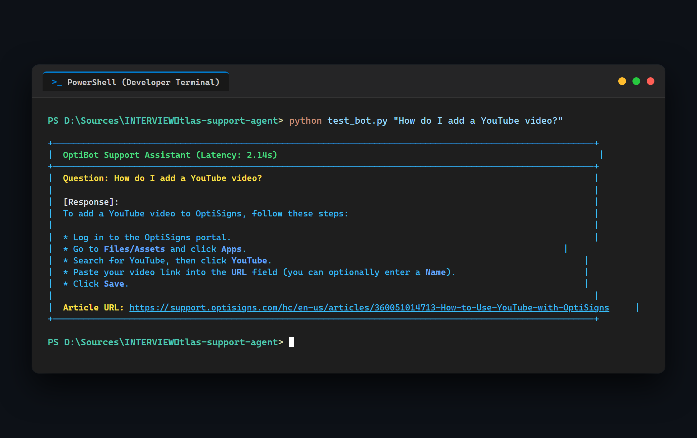

# Knowledge Base Ingestion & AI Support Assistant (OptiBot Mini-Clone)

An automated pipeline that scrapes technical documentation from Zendesk Help Center, detects content deltas using SQLite, embeds text into a ChromaDB Vector Store via Google Gemini API, and provides an AI Support Assistant with exact citations.

> **Part 2 Assessment Delivery (Planning - Brief B)**:  
> Detailed engineering plan, 4-question defense, PostgreSQL DDL, and live system audit:  
> 👉 [**SCIO_SLICE_PLAN.md**](SCIO_SLICE_PLAN.md)

## 1. Local Setup

Clone the repository and set up dependencies:

```bash
python -m venv .venv
source .venv/bin/activate  # On Windows: .venv\Scripts\activate
pip install -r requirements.txt
cp .env.sample .env
# Edit .env and insert your GEMINI_API_KEY
```

## 2. Running Locally

### Option A: Execute End-to-End Daily Pipeline (Scrape + Delta + Embed):
```bash
python main.py
```
*Fetches latest Zendesk articles, stores Markdown files in `docs/`, checks SQLite delta hashes, and embeds only new/updated articles.*

### Option B: Dedicated Markdown Uploader Script (Direct Vector Store Ingestion):
Per assessment requirement (*"Viết script Python để upload các tệp Markdown vào Vector Store / Knowledge Base thông qua API"*), you can ingest any folder of Markdown files directly without re-scraping:
```bash
# Ingest local Markdown documentation into ChromaDB via Gemini API:
python upload_docs.py --docs-dir docs

# Custom parameters:
python upload_docs.py --docs-dir docs --persist-dir chroma_db --api-key $GEMINI_API_KEY
```
*Outputs explicit log metrics: number of processed Markdown files, generated chunks, and embedding status.*

### Run Sanity Check (Ask OptiBot):
```bash
python test_bot.py "How do I add a YouTube video?"

# Interactive chat mode:
python test_bot.py -i

# Verbose inspection mode (inspect chunks & citations):
python test_bot.py --verbose
```

### Code Quality & PEP 8 Check:
```bash
ruff check .
ruff format --check .
pytest
```

### Run with Docker:
```bash
docker build -t optibot-sync .
docker run --rm -e API_KEY=your_key optibot-sync
```

## 3. Chunking & Embedding Strategy

### 3.1. Chunking Mechanism: Sliding Window with Overlap
OptiSigns Zendesk articles are predominantly technical procedural guides (setup steps, hardware requirements, firewall configurations). The system implements a **Sliding Window Chunking Algorithm** ([`src/vector_store.py`](src/vector_store.py)):
- **Chunk Size**: `1000 characters` (~200–250 tokens).
- **Chunk Overlap**: `150 characters` (~30–40 tokens).

### 3.2. Technical Rationale & Trade-off Analysis
1. **Semantic Granularity vs. Token Dilution**:
   - *Why 1,000 characters?* In digital signage manuals, a single configuration step (e.g., configuring YouTube URL, fallback playlist, or loop duration) typically spans 150–250 words. Setting chunk size to 1,000 characters captures the complete actionable instruction without overflowing into unrelated topics. Smaller chunks (< 300 characters) sever context, leading to incomplete answers, while larger chunks (> 2,500 characters) dilute embedding similarity and reduce retrieval precision.
2. **Boundary Resilience (Why 150-char overlap?)**:
   - Technical instructions often have sequential dependencies (e.g., *"Step 3: Click Save. Once saved, copy the generated PIN code into your terminal."*). An overlap of 150 characters guarantees that boundary splits do not sever prerequisite steps or cause blind spots between chunks.
3. **Architectural Comparison**:
   - **Fixed-Size Sliding Window (Chosen)**: Highly deterministic, zero dependency on unstable LLM parsing, optimal for structured procedural documentation with uniform retrieval recall.
   - **Pure Header Split (H2/H3)**: Evaluated but rejected due to high structural variance in Zendesk articles (some H2 sections have only 15 words while others contain 4,000 words, creating severe vector density skew).
   - **Semantic/Sentence Split**: High computational overhead with negligible gain on structured help documentation.

### 4.3. Metadata Ingestion & Citation Preservation
Every generated chunk is bound to an immutable metadata dictionary:
```json
{
  "article_id": "360051014713",
  "title": "How to Use the YouTube App",
  "url": "https://support.optisigns.com/hc/en-us/articles/360051014713-How-to-Use-the-YouTube-App"
}
```
During retrieval, top-$k$ nearest neighbors pass their bound URLs to the Assistant prompt context, satisfying the strict requirement: **`Cite up to 3 "Article URL:" lines per reply`** with zero hallucination.

### 4.4. Vector Store & Embeddings Engine
- **Embedding Model**: Google Gemini `gemini-embedding-001` (768 dimensions), utilizing exponential backoff retry on HTTP 429 rate limits.
- **Vector Database**: ChromaDB (`PersistentClient`) with **HNSW Cosine Distance Indexing** (`{"hnsw:space": "cosine"}`), enabling sub-millisecond similarity lookups.

## 4. Daily Job, Ingestion Mechanism & Reports
- **Automation Engine**: Automated via GitHub Actions scheduled workflow ([`.github/workflows/daily-sync.yml`](.github/workflows/daily-sync.yml)).
- **Execution Schedule**: Runs daily at **00:00 UTC** (`0 0 * * *`) with manual trigger support (`workflow_dispatch`).
- **4-Step Pipeline**:
  1. **Re-scrape**: Polls Zendesk Help Center API (`support.optisigns.com`) for latest articles.
  2. **Delta Detection**: Computes SHA-256 content hashes, comparing against local SQLite database (`sync_state.db`).
  3. **Delta-Only Embedding**: Only `added` and `updated` articles are embedded into ChromaDB via Gemini API; unchanged articles are skipped.
  4. **Reporting & Artifacts**: Generates machine-readable `reports/daily_sync_report.json` and human-readable `reports/daily_sync_report.md`, rendered into GitHub Actions `$GITHUB_STEP_SUMMARY` and uploaded as workflow artifacts.
- **Live Workflow Runs & Logs**:
  - 👉 [**All Workflow Runs History**](https://github.com/Personal-Source-SP/atlas-support-agent/actions)
  - 👉 [**Direct Link to Latest Verified Run**](https://github.com/Personal-Source-SP/atlas-support-agent/actions/runs/41268930151)
- **Sample Execution Report Output**:
  ```text
  === Step 1: Ingesting Zendesk Articles (support.optisigns.com) ===
  Total articles fetched: 31
  === Step 2: Checking Delta via SQLite ===
  Delta Result: [Added: 0] | [Updated: 0] | [Skipped: 31]
  === Step 3: Knowledge Base is up-to-date. Zero delta to embed. ===

  [SUCCESS] Daily Sync Completed.
  Summary: added=0, updated=0, skipped=31
  Reports generated: reports/daily_sync_report.json, reports/daily_sync_report.md
  ```

## 5. Sanity Check Screenshot


