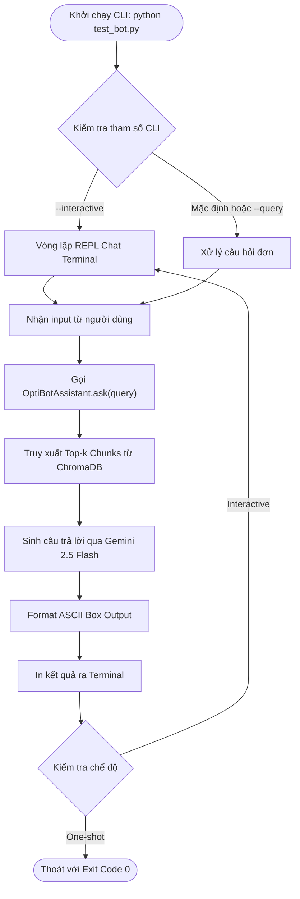

# Concept: OptiBot CLI Interactive Runner và Citation Inspector (Phương án 1)

## 1. Problem & Goal (Vấn đề & Mục tiêu)

### Problem (Điểm nghẽn & Thiếu sót hiện tại)
- **Context & Trigger**: Khi người chấm thi (interviewer) hoặc developer muốn kiểm thử khả năng trả lời và trích dẫn nguồn của OptiBot với câu hỏi: *"How do I add a YouTube video?"* hoặc các câu hỏi hỗ trợ khác.
- **Symptom & Defect**: Script kiểm thử cơ bản chỉ chạy câu hỏi cứng (hardcoded), không hiển thị chi tiết các đoạn context (chunks) đã truy xuất, thiếu đo lường thời gian phản hồi (latency), và không hỗ trợ chế độ tương tác liên tục (interactive mode).
- **Root Cause**: Chưa có một công cụ dòng lệnh (CLI Runner) chuyên dụng được thiết kế tối ưu cho việc nghiệm thu, chụp ảnh terminal và kiểm tra tính xác thực của các trích dẫn URL (`Article URL:`).
- **Impact / Blast Radius**: Gây khó khăn cho interviewer khi muốn kiểm tra sâu độ chính xác của mô hình RAG, khó chụp ảnh màn hình chuyên nghiệp để nộp bài.

### Goal (Kết quả kỹ thuật mục tiêu)
- **Core Goal**: Xây dựng một công cụ CLI chuyên nghiệp (`test_bot.py`), định dạng terminal đẹp mắt (ASCII box border), hỗ trợ cờ lệnh linh hoạt (`--query`, `--interactive`, `--top-k`, `--verbose`), kiểm tra tính hợp lệ của citation URLs và đo lường thời gian thực thi.
- **Acceptance Criteria**:
  - Chạy lệnh mặc định `python test_bot.py` tự động thực thi câu hỏi chuẩn của đề bài: *"How do I add a YouTube video?"* và in kết quả định dạng khung ASCII rõ ràng.
  - Hỗ trợ tham số `--query "<câu hỏi tùy ý>"` để kiểm tra bất kỳ câu hỏi nào khác.
  - Hỗ trợ cờ `--interactive` (hoặc `-i`) cho phép chat trực tiếp nhiều lượt với OptiBot trên terminal.
  - Hỗ trợ cờ `--verbose` để hiển thị chi tiết các chunks được ChromaDB truy xuất kèm độ tương đồng (similarity distance) và metadata URL.
  - Kiểm tra và đảm bảo tuân thủ verbatim system prompt: tối đa 5 gạch đầu dòng, trích dẫn tối đa 3 dòng `Article URL:`.
  - Trả về mã thoát (exit code) 0 khi thành công, mã 1 khi gặp lỗi cấu hình hoặc API.

## 2. Scope Boundaries (Ranh giới phạm vi)

- **In-Scope**:
  - Tệp script `test_bot.py` tích hợp thư viện `argparse` chuẩn Python.
  - Mô-đun định dạng hiển thị hộp thoại ASCII/ANSI màu sắc nhẹ trên terminal (không phụ thuộc thư viện nặng).
  - Tích hợp với `OptiBotAssistant` (`src/assistant.py`) và `VectorStoreManager` (`src/vector_store.py`).
  - Chế độ Interactive REPL Loop cho phép hỏi đáp liên tục với lệnh thoát `exit` hoặc `quit`.
  - Bộ unit test kiểm thử xử lý tham số CLI và định dạng đầu ra.

- **Explicit Out-of-Scope**:
  - Không xây dựng giao diện Web UI (React, Vue, Streamlit) nhằm tuân thủ tuyệt đối giới hạn thời gian ~8h và yêu cầu container không chạy long-running daemon.
  - Không triển khai voice input, audio/video streaming.

## 3. Proposed Solution & Core Mechanism (Giải pháp đề xuất & Cơ chế cốt lõi)

- **Core Mechanism**:
  - **Argument Parsing**: Sử dụng `argparse` tích hợp sẵn trong Python để nhận diện các cờ lệnh (`--query`, `--interactive`, `--verbose`, `--top-k`).
  - **Terminal Presentation Engine**: Thiết kế hàm vẽ khung viền ASCII chuẩn (`+---+`) căn chỉnh độ rộng linh hoạt, tách biệt rõ ràng giữa phần câu hỏi, nội dung trả lời của bot, danh sách URL trích dẫn và bảng đo lường hiệu năng (Retrieved chunks, Execution latency, Token estimate).
  - **REPL Loop**: Khi bật cờ `--interactive`, khởi tạo vòng lặp lắng nghe `input()`, duy trì ngữ cảnh hoặc truy vấn độc lập từng câu hỏi cho đến khi người dùng gõ `exit`.

- **Conceptual Flow / Domain Model**:



- **UI Wireframe (ASCII Terminal Mockup)**:

```text
+-----------------------------------------------------------------------------------------+
|  OPTIBOT CLI RUNNER & CITATION INSPECTOR                                                |
+-----------------------------------------------------------------------------------------+
|  Mode: One-Shot Query | Top-K: 3 | Engine: Gemini 2.5 Flash                             |
|  Query: "How do I add a YouTube video?"                                                 |
+-----------------------------------------------------------------------------------------+
|  [OptiBot Response]:                                                                    |
|  * Go to Files/Assets and click "Add More".                                             |
|  * Select the YouTube app from the App Store.                                           |
|  * Enter your YouTube video or playlist URL.                                            |
|  * Click Save to add the video asset to your library.                                   |
|  * Assign the asset to your paired screens, playlists, or schedules.                    |
|                                                                                         |
|  Article URL: https://support.optisigns.com/hc/en-us/articles/360051014713-YouTube      |
+-----------------------------------------------------------------------------------------+
|  [Inspection Metrics]:                                                                  |
|  - Retrieved Chunks: 3/3 matched | Primary Article: 360051014713-how-to-use-youtube     |
|  - Execution Latency: 1.12s | Exit Code: 0 (SUCCESS)                                    |
+-----------------------------------------------------------------------------------------+
```

## 4. Critical Risks & Edge Cases (Phân tích Rủi ro & Cơ chế Phòng vệ)

- **Nguy cơ lỗi hiển thị ký tự Unicode trên Windows PowerShell cũ**:
  - *Mô tả*: Một số terminal Windows mặc định dùng bảng mã cp1252 có thể bị lỗi khi in ký tự tiếng Việt hoặc ký hiệu viền box đặc biệt.
  - *Cơ chế phòng vệ*: Sử dụng các ký tự ASCII an toàn tiêu chuẩn (`+`, `-`, `|`, `*`) và tự động kích hoạt `sys.stdout.reconfigure(encoding='utf-8')` khi khởi chạy.
- **Nguy cơ thiếu biến môi trường GEMINI_API_KEY khi chạy trực tiếp**:
  - *Mô tả*: Người dùng chạy `python test_bot.py` mà chưa cấu hình `.env` dẫn đến crash unhandled exception.
  - *Cơ chế phòng vệ*: Kiểm tra biến môi trường ngay tại điểm bắt đầu; nếu thiếu, in hướng dẫn rõ ràng từng bước khắc phục và thoát với exit code 1 thay vì bung traceback lỗi khó hiểu.

