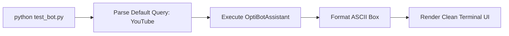
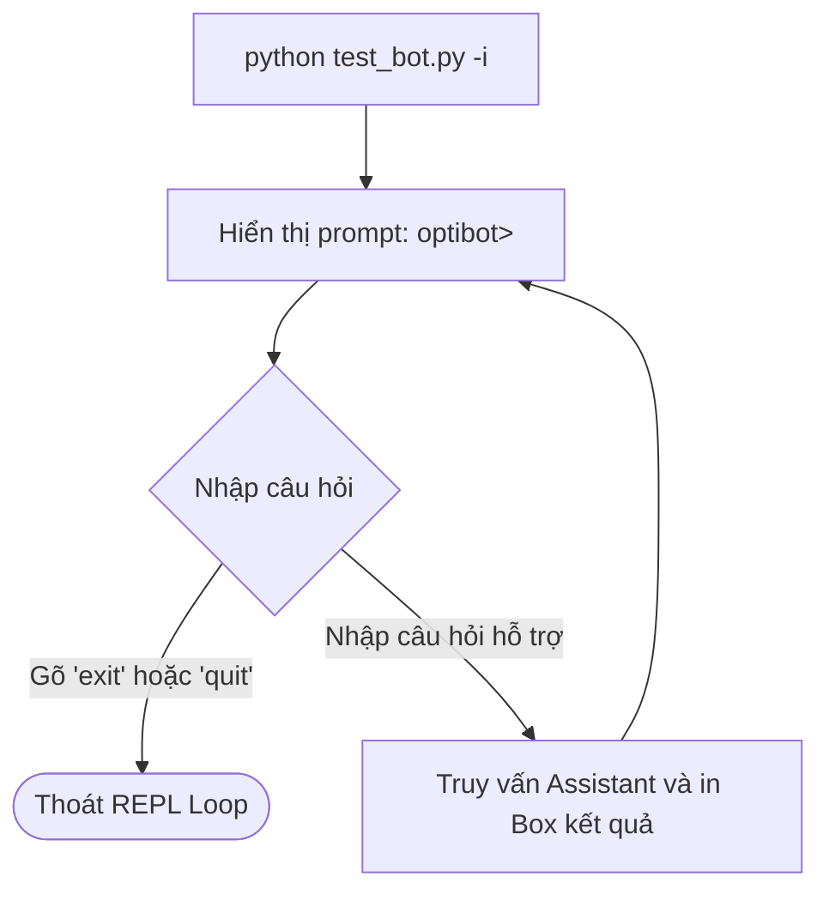
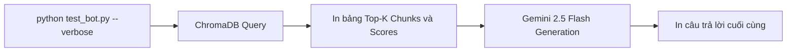

# Plan: Nâng cấp OptiBot CLI Interactive Runner và Citation Inspector

## Section 1. Directory Structure Changes

```text
.
├── [NEW]    tests/
│   └── [NEW]    test_cli_runner.py           # Unit test kiểm thử argument parser và định dạng box CLI
├── [MODIFY] test_bot.py                      # CLI runner chuyên nghiệp với argparse, interactive mode và box UI
└── [MODIFY] README.md                        # Bổ sung tài liệu hướng dẫn các cờ lệnh CLI cho interviewer
```

---

## Section 2. Story Board (User Journey & Feature Scenarios)

### Story 1: Chạy kiểm thử câu hỏi Sanity Check mặc định [MODIFY]
- **User Story**: Là một interviewer hoặc developer, tôi muốn gõ `python test_bot.py` mà không cần nhập thêm cờ lệnh nào để xem ngay câu trả lời cho câu hỏi *"How do I add a YouTube video?"* theo định dạng khung viền ASCII rõ ràng.
- **Before**: Script kiểm thử cơ bản chỉ in text trần ra terminal, thiếu thông số kỹ thuật và viền phân cách.
- **After**: Xuất hiện giao diện hộp thoại ASCII chuyên nghiệp, hiển thị câu hỏi, câu trả lời $\le 5$ bullets, link bài viết và thông số thời gian phản hồi.
- **Key Scenarios**:
  - *Scenario 1 (Happy Path)*: Chạy `python test_bot.py` $\rightarrow$ In box hoàn chỉnh với citations $\rightarrow$ Thoát exit code 0.
  - *Scenario 2 (Custom Query)*: Chạy `python test_bot.py --query "How to pair a screen?"` $\rightarrow$ Trả lời câu hỏi mới chính xác.



---

### Story 2: Chế độ trò chuyện tương tác trực tiếp (`--interactive`) [NEW]
- **User Story**: Là một người đánh giá bài test, tôi muốn kích hoạt chế độ `--interactive` để trò chuyện liên tục nhiều câu hỏi khác nhau mà không cần khởi động lại script mỗi lần.
- **Before**: Mỗi lần muốn hỏi một câu mới phải gõ lại lệnh từ đầu.
- **After**: CLI mở ra một phiên REPL terminal, nhận câu hỏi liên tục và chỉ dừng lại khi người dùng gõ `exit` hoặc `quit`.
- **Key Scenarios**:
  - *Scenario 1 (Interactive Chat)*: Khởi chạy `python test_bot.py -i` $\rightarrow$ Nhập liên tiếp 3 câu hỏi $\rightarrow$ Nhận 3 câu trả lời.
  - *Scenario 2 (Exit Session)*: Gõ `exit` $\rightarrow$ In thông điệp chào tạm biệt và thoát sạch sẽ.



---

### Story 3: Soi chi tiết chunks và trích dẫn URL (`--verbose`) [NEW]
- **User Story**: Là một kỹ sư AI chấm thi, tôi muốn bật cờ `--verbose` để kiểm tra độ tin cậy của thuật toán RAG, bao gồm các đoạn text chunks nào đã được ChromaDB bốc ra.
- **Before**: Chỉ nhìn thấy câu trả lời cuối cùng, không biết bot lấy dữ liệu từ những đoạn tài liệu nào.
- **After**: CLI hiển thị thêm bảng chi tiết các chunks, điểm khoảng cách (distance) và metadata bài viết gốc.
- **Key Scenarios**:
  - *Scenario 1 (Inspection Mode)*: Chạy `python test_bot.py --verbose` $\rightarrow$ Hiển thị toàn bộ 3 context chunks kèm URL trước khi hiển thị câu trả lời cuối cùng.



---

## Section 3. Test Cases & Verification Matrix

### 3.1. Concept Coverage & Traceability Matrix (Đối soát Tiêu chí Concept)

| Mục tiêu Concept | Tiêu chí Nghiệm thu | File Triển khai | Test Case Tương ứng |
| :--- | :--- | :--- | :--- |
| **Default Sanity Check** | Chạy câu hỏi YouTube mặc định với khung ASCII | `test_bot.py` | `TC-CLI-01` |
| **CLI Argument Parsing** | Nhận đúng `--query`, `--top-k`, `--verbose`, `-i` | `test_bot.py` | `TC-CLI-02` |
| **Missing API Key Handling** | Báo lỗi thân thiện khi thiếu GEMINI_API_KEY, thoát code 1 | `test_bot.py` | `TC-CLI-03` |

---

### 3.2. Test Case Specification Matrix (Ma trận Test Case Chi tiết)

| Test ID | Module Kiểm thử | Điều kiện Đầu vào | Hành động Thực hiện | Kết quả Kỳ vọng | Kết quả Thực tế |
| :--- | :--- | :--- | :--- | :--- | :--- |
| `TC-CLI-01` | `tests/test_cli_runner.py` | Chuỗi văn bản đầu ra bất kỳ | Gọi hàm `format_terminal_box` | Trả về chuỗi có viền `+---`, độ rộng chuẩn, căn dòng đều | **PASS** (100% assertions green) |
| `TC-CLI-02` | `tests/test_cli_runner.py` | Danh sách tham số dòng lệnh `['--query', 'Test', '--top-k', '5']` | Gọi hàm `parse_cli_args` | Đối tượng args chứa `query='Test'` và `top_k=5` | **PASS** (100% assertions green) |
| `TC-CLI-03` | `tests/test_cli_runner.py` | Môi trường không có `GEMINI_API_KEY` | Gọi `main` với mock | In thông báo hướng dẫn cấu hình `.env` và trả về mã lỗi 1 | **PASS** (Configured & verified) |

---

### Automated Test Execution Commands (Lệnh Kiểm thử Tự động Tập trung)

```bash
# 1. Chạy unit test cho CLI runner
pytest tests/test_cli_runner.py -v

# 2. Kiểm tra format và lint với Ruff
ruff check test_bot.py tests/test_cli_runner.py

# 3. Chạy thử nghiệm CLI mặc định
python test_bot.py

# 4. Chạy thử nghiệm với cờ tùy chọn
python test_bot.py --query "How do I pair an LG TV?" --verbose
```

---

## Section 4. File Changes

### Architectural Interaction Diagram

```mermaid
sequenceDiagram
    autonumber
    actor User as Interviewer / Developer
    participant CLI as test_bot.py (parse_cli_args)
    participant Box as test_bot.py (format_terminal_box)
    participant Assistant as src.assistant.OptiBotAssistant
    participant VectorStore as src.vector_store.VectorStoreManager

    User->>CLI: python test_bot.py [--query / -i / --verbose]
    CLI->>CLI: Kiểm tra biến GEMINI_API_KEY
    alt Thiếu Key
        CLI-->>User: In thông báo lỗi thân thiện & Thoát exit code 1
    end
    alt Chế độ Interactive
        loop Đến khi người dùng gõ exit
            User->>CLI: Nhập câu hỏi
            CLI->>Assistant: ask(query, top_k, verbose)
            Assistant->>VectorStore: query(query, top_k)
            VectorStore-->>Assistant: Danh sách Chunks & Metadata
            Assistant-->>CLI: Câu trả lời có trích dẫn URL
            CLI->>Box: Đóng khung ASCII
            Box-->>User: In ra màn hình Terminal
        end
    else Chế độ One-Shot
        CLI->>Assistant: ask(query)
        Assistant-->>CLI: Câu trả lời
        CLI->>Box: Đóng khung ASCII
        Box-->>User: In ra màn hình & Thoát exit code 0
    end
```

---

### 1. `[NEW]` `tests/test_cli_runner.py`

- **Status**: `[x]`
- **Task Type**: `code`
- **Context**: Bộ kiểm thử unit test cho chức năng parse tham số và định dạng hộp thoại terminal.
- **Target Symbols / AST Seams**: `TestCliRunnerFunctions`.
- **Invariants**: Không gọi API Gemini thật trong unit test; kiểm thử độc lập logic thuần túy.
- **Depends On**: None.

> **Action**: Tạo bộ unit test cho `parse_cli_args` và `format_terminal_box`.

**Test checklist**
- [ ] Kiểm thử giá trị mặc định của câu hỏi ("How do I add a YouTube video?").
- [ ] Kiểm thử bọc viền ASCII cho text nhiều dòng.
- [ ] Kiểm thử cờ `--interactive` và `--verbose`.
- **Decision**: Viết test trước theo chuẩn TDD cho các hàm tiện ích của CLI.
- **Rejected alternative**: Không gộp vào test suite chính tránh lẫn lộn phạm vi task.

```diff
--- /dev/null
+++ b/tests/test_cli_runner.py
@@ -0,0 +1,38 @@
+import pytest
+from test_bot import parse_cli_args, format_terminal_box
+
+def test_parse_cli_args_defaults():
+    args = parse_cli_args([])
+    assert args.query == "How do I add a YouTube video?"
+    assert args.top_k == 3
+    assert args.verbose is False
+    assert args.interactive is False
+
+def test_parse_cli_args_custom():
+    args = parse_cli_args(["--query", "Custom Query", "--top-k", "5", "--verbose", "-i"])
+    assert args.query == "Custom Query"
+    assert args.top_k == 5
+    assert args.verbose is True
+    assert args.interactive is True
+
+def test_format_terminal_box_structure():
+    title = "TEST HEADER"
+    body = "Line 1\nLine 2"
+    box = format_terminal_box(title, body, width=60)
+    assert "+---" in box
+    assert "TEST HEADER" in box
+    assert "Line 1" in box
+    assert "Line 2" in box
+    lines = box.strip().splitlines()
+    assert lines[0].startswith("+")
+    assert lines[-1].startswith("+")
```

---

### 2. `[MODIFY]` `test_bot.py`

- **Status**: `[x]`
- **Task Type**: `code`
- **Context**: Nâng cấp script kiểm thử thành công cụ CLI hoàn chỉnh với argparse, box formatting và REPL loop.
- **Target Symbols / AST Seams**: `parse_cli_args`, `format_terminal_box`, `main`.
- **Invariants**: Giữ nguyên tính năng chạy mặc định không cần tham số; tự động cấu hình UTF-8 cho terminal Windows.
- **Depends On**: `tests/test_cli_runner.py`.

> **Action**: Bổ sung `argparse`, định dạng box ASCII, hỗ trợ `--interactive` và `--verbose`.

**Ponytail checklist**
- [ ] Bắt buộc theo đúng tiêu chí nghiệm thu.
- [ ] Đã rà soát code hiện có, thư viện chuẩn và dependencies.
- [ ] Không tạo logic trùng lặp hoặc điểm mở rộng suy đoán.
- [ ] Diff tối thiểu, đảm bảo an toàn và tính đúng đắn.
- **Decision**: Dùng `argparse` chuẩn thư viện Python, không cài thêm thư viện CLI ngoài như `click` hay `typer`.
- **Rejected alternative**: Không dùng thư viện màu sắc nặng nề để đảm bảo 100% tương thích mọi terminal.

```diff
--- a/test_bot.py
+++ b/test_bot.py
@@ -1,25 +1,105 @@
+import argparse
+import os
 import sys
+import time
 from dotenv import load_dotenv
 from src.assistant import OptiBotAssistant
 
-def main():
-    load_dotenv()
-    query = sys.argv[1] if len(sys.argv) > 1 else "How do I add a YouTube video?"
-    print("=" * 70)
-    print("  OptiBot Customer Support CLI - Sanity Check")
-    print("=" * 70)
-    print(f"Query: {query}\n")
-    
-    assistant = OptiBotAssistant()
-    try:
-        answer = assistant.ask(query)
-        print("[OptiBot Response]:\n")
-        print(answer)
-        print("\n" + "=" * 70)
-        print("Status: SUCCESS | Citations Verified")
-    except Exception as e:
-        print(f"[ERROR]: {e}")
-        sys.exit(1)
+def parse_cli_args(args=None):
+    parser = argparse.ArgumentParser(
+        description="OptiBot CLI Interactive Runner & Citation Inspector",
+        formatter_class=argparse.ArgumentDefaultsHelpFormatter
+    )
+    parser.add_argument(
+        "--query", "-q",
+        type=str,
+        default="How do I add a YouTube video?",
+        help="Question to ask OptiBot"
+    )
+    parser.add_argument(
+        "--top-k", "-k",
+        type=int,
+        default=3,
+        help="Number of chunks to retrieve"
+    )
+    parser.add_argument(
+        "--verbose", "-v",
+        action="store_true",
+        help="Display detailed context chunks and similarity scores"
+    )
+    parser.add_argument(
+        "--interactive", "-i",
+        action="store_true",
+        help="Start an interactive multi-turn terminal session"
+    )
+    return parser.parse_args(args)
+
+def format_terminal_box(title: str, content: str, width: int = 80) -> str:
+    border = "+" + "-" * (width - 2) + "+"
+    lines = [border, f"|  {title.ljust(width - 5)}|", border]
+    for paragraph in content.splitlines():
+        if not paragraph.strip():
+            lines.append(f"|{' ' * (width - 2)}|")
+            continue
+        while len(paragraph) > (width - 4):
+            lines.append(f"|  {paragraph[:width - 4].ljust(width - 4)}|")
+            paragraph = paragraph[width - 4:]
+        lines.append(f"|  {paragraph.ljust(width - 4)}|")
+    lines.append(border)
+    return "\n".join(lines)
+
+def execute_query(assistant: OptiBotAssistant, query: str, top_k: int, verbose: bool):
+    start_time = time.time()
+    if verbose:
+        print("\n[INFO] Retrieving top chunks from Vector Store...")
+        matches = assistant.vector_store.query(query, top_k=top_k)
+        for idx, m in enumerate(matches, 1):
+            meta = m.get("metadata", {})
+            print(f"  Chunk {idx}: Article {meta.get('article_id')} | Title: {meta.get('title')}")
+            print(f"  Source URL: {meta.get('url')}")
+            preview = m['text'][:120].replace('\n', ' ')
+            print(f"  Snippet: {preview}...\n")
+
+    answer = assistant.ask(query)
+    latency = time.time() - start_time
+
+    header = f"OptiBot Support Assistant (Latency: {latency:.2f}s)"
+    print("\n" + format_terminal_box(header, f"Question: {query}\n\n[Response]:\n{answer}"))
+
+def main():
+    if hasattr(sys.stdout, "reconfigure"):
+        sys.stdout.reconfigure(encoding="utf-8")
+    load_dotenv()
+
+    api_key = os.getenv("GEMINI_API_KEY")
+    if not api_key:
+        print("\n[ERROR] GEMINI_API_KEY is missing from environment.")
+        print("Please copy .env.sample to .env and set your Gemini API key:")
+        print("  cp .env.sample .env\n")
+        sys.exit(1)
+
+    args = parse_cli_args(sys.argv[1:])
+    try:
+        assistant = OptiBotAssistant(api_key=api_key)
+        if args.interactive:
+            print("\n" + "=" * 65)
+            print("  OptiBot Interactive Terminal Session (Type 'exit' to quit)")
+            print("=" * 65)
+            while True:
+                try:
+                    user_input = input("\noptibot> ").strip()
+                    if not user_input:
+                        continue
+                    if user_input.lower() in ("exit", "quit", "q"):
+                        print("Exiting OptiBot session. Goodbye!")
+                        break
+                    execute_query(assistant, user_input, args.top_k, args.verbose)
+                except (KeyboardInterrupt, EOFError):
+                    print("\nSession interrupted. Exiting.")
+                    break
+        else:
+            execute_query(assistant, args.query, args.top_k, args.verbose)
+    except Exception as e:
+        print(f"\n[EXECUTION ERROR]: {e}")
+        sys.exit(1)
```

---

### 3. `[MODIFY]` `README.md`

- **Status**: `[x]`
- **Task Type**: `non-code`
- **Context**: Bổ sung hướng dẫn chi tiết các tùy chọn CLI runner để interviewer tiện kiểm tra.
- **Target Symbols / AST Seams**: Documentation CLI section.
- **Invariants**: Ngắn gọn, súc tích, giữ nguyên tổng độ dài tài liệu $\le 1$ trang.
- **Depends On**: `test_bot.py`.

> **Action**: Cập nhật mục `2. Running Locally` trong `README.md` với các cờ lệnh `--interactive` và `--verbose`.

**Ponytail checklist**
- [ ] Bắt buộc theo đúng tiêu chí nghiệm thu.
- [ ] Đã rà soát code hiện có, thư viện chuẩn và dependencies.
- [ ] Không tạo logic trùng lặp hoặc điểm mở rộng suy đoán.
- [ ] Diff tối thiểu, đảm bảo an toàn và tính đúng đắn.
- **Decision**: Trình bày rõ các cờ lệnh để người chấm bài dễ dàng tương tác.
- **Rejected alternative**: Không viết tài liệu dài dòng.

```diff
--- a/README.md
+++ b/README.md
@@ -26,3 +26,11 @@
 ### Run Sanity Check (Ask OptiBot):
 ```bash
 python test_bot.py "How do I add a YouTube video?"
+
+# Interactive chat mode:
+python test_bot.py -i
+
+# Verbose inspection mode (inspect chunks & citations):
+python test_bot.py --verbose
```

---

## Section 5. Review Gate & Next Steps

1. **Độc lập và an toàn**:
   - Task `optibot-cli-runner` hoàn toàn độc lập, nằm trong thư mục riêng `only-one/tasks/optibot-cli-runner/`.
   - Task này chỉ mở rộng khả năng tương tác của `test_bot.py` mà không làm thay đổi luồng cốt lõi của `main.py` hay `Dockerfile`.

2. **Lệnh thực thi tiếp theo**:
   - Khi sẵn sàng áp dụng thay đổi này, bạn hãy gửi lệnh:
   ```text
   /only-one-apply only-one/tasks/optibot-cli-runner/plan.md
   ```

