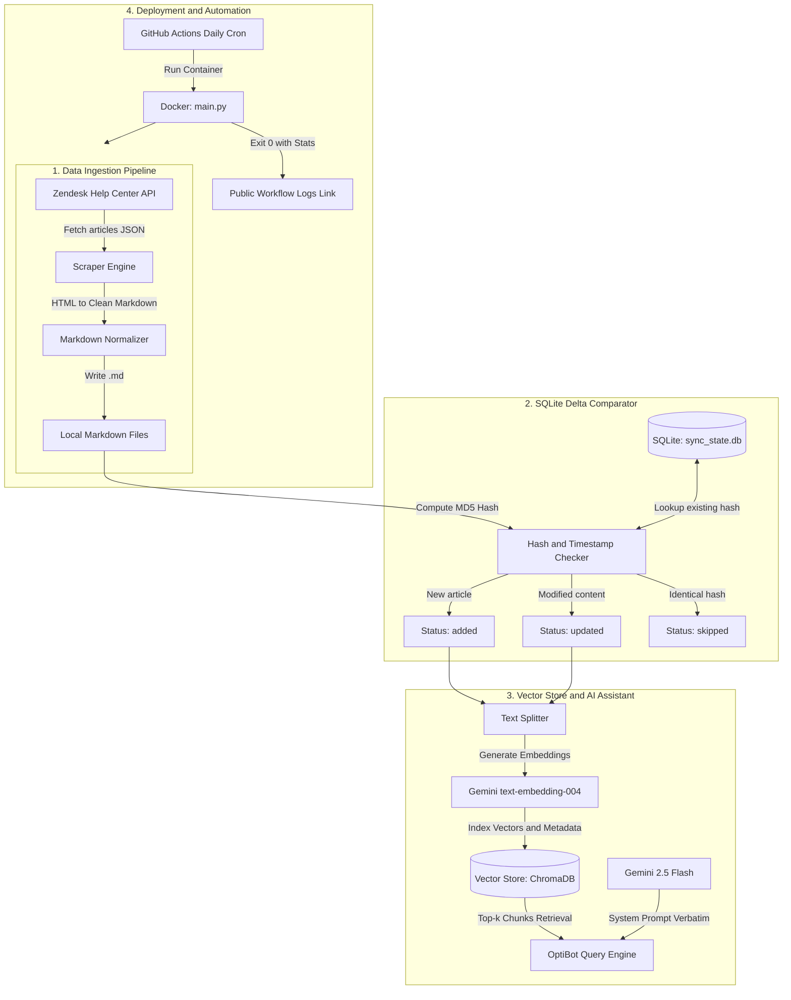

# Concept: OptiBot Mini-Clone Knowledge Base và Daily Delta Sync

## 1. Problem & Goal (Vấn đề & Mục tiêu)

### Problem (Điểm nghẽn & Thiếu sót hiện tại)
- **Context & Trigger**: Khách hàng sử dụng dịch vụ bảng hiệu số OptiSigns thường xuyên gặp các thắc mắc lặp lại về cấu hình và tính năng (ví dụ: cách thêm YouTube video, ghép đôi màn hình, tạo playlist).
- **Symptom & Defect**: Đội ngũ Customer Support phải xử lý thủ công các câu hỏi đã có sẵn câu trả lời chi tiết trên trang Help Center (`support.optisigns.com`).
- **Root Cause**: Thiếu một kênh trợ lý tự động có khả năng tra cứu ngữ nghĩa trực tiếp từ kho tài liệu hỗ trợ kỹ thuật và phản hồi tức thì với dẫn chứng chính xác.
- **Impact / Blast Radius**: Tốn kém chi phí nhân sự hỗ trợ, kéo dài thời gian phản hồi của khách hàng và gây lãng phí nguồn tài nguyên tri thức hiện hữu.

### Goal (Kết quả kỹ thuật mục tiêu)
- **Core Goal**: Xây dựng một trợ lý AI (OptiBot Mini-Clone) sử dụng Google Gemini API để giải đáp thắc mắc người dùng dựa hoàn toàn trên tài liệu Help Center, kèm cơ chế tự động hóa crawl và cập nhật dữ liệu delta hàng ngày qua Docker và GitHub Actions.
- **Acceptance Criteria**:
  - Thu thập tối thiểu 30 bài viết từ `support.optisigns.com` qua Zendesk Help Center API và chuyển đổi thành Markdown sạch (`<slug>.md`), giữ lại link, code block, heading và loại bỏ nav/ads.
  - Tự động nạp tài liệu vào Vector Store thông qua API bằng model `text-embedding-004` và ChromaDB, ghi nhận số lượng file và chunk đã embed.
  - Cấu hình Assistant tuân thủ nghiêm ngặt verbatim system prompt: tông giọng factual/concise, chỉ trả lời từ tài liệu đã nạp, tối đa 5 gạch đầu dòng, trích dẫn tối đa 3 dòng `Article URL:`.
  - Vượt qua bài kiểm tra sanity check với câu hỏi: *"How do I add a YouTube video?"* kèm ảnh chụp màn hình minh chứng trích dẫn nguồn chính xác.
  - Đóng gói toàn bộ pipeline thành Dockerfile chạy một lần với lệnh `docker run -e GEMINI_API_KEY=... main.py` và thoát với exit code 0.
  - Thiết lập cronjob GitHub Actions chạy định kỳ mỗi ngày 1 lần, phát hiện chính xác số lượng bài viết `added`, `updated`, `skipped` và xuất link log công khai.

## 2. Scope Boundaries (Ranh giới phạm vi)

- **In-Scope**:
  - Script thu thập dữ liệu tự động từ Zendesk Help Center API của OptiSigns ($\ge 30$ bài).
  - Trình làm sạch HTML và chuyển đổi cấu trúc Markdown chuẩn hóa.
  - Cơ chế nhận diện delta (added / updated / skipped) dựa trên mã băm MD5 và bảng SQLite `sync_state.db`.
  - Pipeline chunking văn bản và sinh embedding lưu vào local ChromaDB Vector Store.
  - Engine truy vấn OptiBot tích hợp Google Gemini API (`gemini-2.5-flash`).
  - Script kiểm thử sanity check (CLI / Terminal output) để chụp ảnh bằng chứng nghiệm thu.
  - Tệp `Dockerfile` đa nền tảng tối ưu kích thước image và xử lý biến môi trường an toàn.
  - Workflow GitHub Actions tự động kích hoạt hàng ngày và lưu trữ log thực thi.
  - Tài liệu `README.md` ($\le 1$ trang) với hướng dẫn cài đặt, chạy local, link logs và ảnh chụp màn hình.

- **Explicit Out-of-Scope**:
  - Không xây dựng giao diện người dùng Web Frontend phức tạp (chỉ dùng terminal CLI / script để sanity check).
  - Không triển khai các tính năng ngoài Brief (như streaming chat UI, quản lý nhiều phiên chat song song, voice input).
  - Không can thiệp hoặc viết kế hoạch cho Part 2 (SCIO Slice Plan) trong phạm vi task này.
  - Không đặt tên repository GitHub chứa từ khóa "optisigns" theo yêu cầu bảo mật đề thi.

## 3. Proposed Solution & Core Mechanism (Giải pháp đề xuất & Cơ chế cốt lõi)

- **Core Mechanism**:
  - **Data Ingestion & Cleaning**: Gọi Zendesk API lấy danh sách bài viết. Dùng thư viện parser HTML bóc tách thẻ nội dung chính, chuyển đổi sang Markdown chuẩn và lưu thành `<slug>.md`.
  - **State & Delta Tracking**: Khởi tạo SQLite database (`sync_state.db`). Mỗi bài viết được băm MD5 phần nội dung. So sánh với database để phân loại: bài mới (`added`), bài có nội dung thay đổi (`updated`), bài giữ nguyên (`skipped`).
  - **Chunking & Vector Indexing**: Các bài viết mới hoặc thay đổi được chia nhỏ thành các đoạn văn bản (chunks) với kích thước tối ưu kèm metadata (`url`, `title`, `slug`). Gọi Google Gemini API (`text-embedding-004`) để lấy vector và lưu vào ChromaDB.
  - **Grounding & Answering**: Khi truy vấn, hệ thống tìm kiếm top-k chunks liên quan nhất từ ChromaDB theo khoảng cách Cosine, ráp vào system prompt verbatim và gọi `gemini-2.5-flash` sinh phản hồi có trích dẫn nguồn URL.
  - **Containerization & CI Automation**: Đóng gói mã nguồn vào Docker image. GitHub Actions chạy container định kỳ hàng ngày, ghi log delta rõ ràng và cung cấp đường link công khai để nộp bài.

- **Conceptual Flow / Domain Model**:



- **UI Wireframe (Sanity Check CLI)**:

```text
+-------------------------------------------------------------------------------+
|  OptiBot Customer Support CLI - Sanity Check Verification                     |
+-------------------------------------------------------------------------------+
|  Input Prompt: "How do I add a YouTube video?"                                |
+-------------------------------------------------------------------------------+
|  [OptiBot Response]:                                                          |
|  To add a YouTube video to OptiSigns:                                         |
|  * Go to Files/Assets and click "Add More".                                   |
|  * Select the YouTube app from the App Store.                                 |
|  * Enter the YouTube video URL and customize playback settings.               |
|  * Click Save to add the video asset to your account.                         |
|  * Assign the asset to your screens, playlists, or schedules.                 |
|                                                                               |
|  Article URL: https://support.optisigns.com/hc/en-us/articles/12345678        |
+-------------------------------------------------------------------------------+
|  [Execution Metrics]:                                                         |
|  Status: SUCCESS | Exit Code: 0 | Retrieved Chunks: 3 | Latency: 1.15s        |
+-------------------------------------------------------------------------------+
```

## 4. Critical Risks & Edge Cases (Phân tích Rủi ro & Cơ chế Phòng vệ)

- **Nguy cơ Zendesk API Rate Limiting hoặc chặn Bot**:
  - *Mô tả*: Gửi quá nhiều request dồn dập có thể bị HTTP 429 Too Many Requests hoặc Cloudflare chặn.
  - *Cơ chế phòng vệ*: Sử dụng endpoint phân trang chuẩn của Zendesk (`page[size]=30`), đặt header `User-Agent` rõ ràng và chèn exponential backoff delay giữa các request.
- **Nguy cơ Gemini API Quota Exceeded (ResourceExhausted)**:
  - *Mô tả*: Việc embed hàng trăm chunk cùng lúc có thể vượt quá giới hạn RPM (Requests Per Minute) của gói miễn phí trên Gemini API.
  - *Cơ chế phòng vệ*: Gom chunk theo batch nhỏ ($\le 20$ texts mỗi call) hoặc thêm throttle delay 0.5s giữa các lần gọi embedding.
- **Nguy cơ Mất dữ liệu SQLite khi chạy trong Docker Ephemeral Container**:
  - *Mô tả*: Khi container chạy xong và thoát (exit 0), dữ liệu SQLite local có thể bị mất nếu không được mount volume.
  - *Cơ chế phòng vệ*: Cấu hình Docker volume mount thư mục `/data` khi chạy local; trên GitHub Actions, sử dụng cache action (`actions/cache`) hoặc lưu database artifact giữa các workflow runs để duy trì trạng thái delta chính xác.
- **Nguy cơ Trích dẫn sai nguồn URL do nội dung phân mảnh (Citation Hallucination)**:
  - *Mô tả*: Mô hình AI tự sinh link không có thật nếu không tìm thấy URL trong context.
  - *Cơ chế phòng vệ*: Gắn chặt metadata `source_url` vào từng chunk văn bản và chèn trực tiếp vào prompt context, đồng thời dùng verbatim system prompt nghiêm cấm tự suy diễn ngoài tài liệu.

