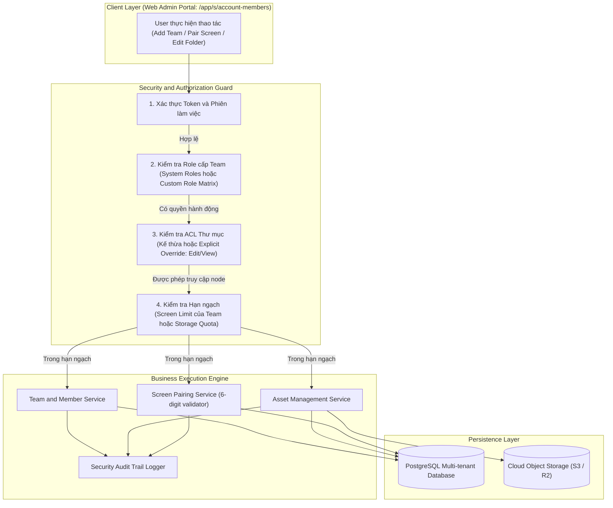

# Concept: SCIO Multi-Tenant Access Control and Resource Management (Brief B)

## 1. Problem and Goal (Vấn đề và Mục tiêu)

### Problem (Điểm nghẽn và Thiếu sót hiện tại)
- **Context & Trigger**: Doanh nghiệp mở rộng quy mô biển hiệu số trên nhiều chi nhánh và phòng ban. Quản trị viên cần phân quyền vận hành độc lập cho từng nhóm nhân viên.
- **Symptom & Defect**: Thiếu ranh giới cô lập dữ liệu gây rò rỉ nội dung giữa các phòng ban. Người dùng cấp thấp có thể can thiệp màn hình hoặc tệp tin nhạy cảm.
- **Root Cause**: Hệ thống thiếu mô hình phân quyền đa tầng kết hợp vai trò tài khoản (RBAC) và danh sách kiểm soát truy cập thư mục (Folder ACL).
- **Impact / Blast Radius**: Nguy cơ phát nhầm nội dung sai lệch lên màn hình công cộng. Vi phạm chính sách bảo mật dữ liệu doanh nghiệp và vượt quá hạn ngạch tài nguyên.

### Goal (Kết quả kỹ thuật mục tiêu)
- **Core Goal**: Xây dựng kiến trúc phân quyền đa tầng và quản lý tài nguyên (Assets, Screens) hoàn chỉnh từ con số 0 cho nền tảng SCIO.
- **Acceptance Criteria**:
  - **Mô hình Unified Workspace (`/app/s/account-members`)**: Mỗi Account chứa nhiều Team độc lập. Tích hợp trực tiếp danh sách Team và thành viên trong một giao diện duy nhất.
  - **Hạn ngạch Màn hình Team (`Number of screens limit`)**: Hỗ trợ thiết lập giới hạn màn hình riêng cho từng Team, kiểm tra với tổng số màn hình khả dụng của Account (`X screens are available`).
  - **Hệ thống Vai trò Đa dạng**: Thực thi 4 System Roles hiển thị cố định (`Owner`, `Admin`, `User`, `Read Only`) cùng công cụ tạo Custom Roles theo ma trận 4 phân hệ x 4 quyền hành động.
  - **Phân quyền Thư mục Phân tầng (Folder ACL Security)**: Hỗ trợ chia sẻ cây thư mục lồng nhau cho cả Assets và Screens với 2 cấp độ quyền chuẩn hóa: **`Edit`** (toàn quyền ghi) và **`View`** (chỉ đọc).
  - **Cơ chế Ghi đè Quyền (Explicit Override)**: Quyền gán trực tiếp tại node thư mục con ghi đè quyền kế thừa từ node cha hoặc role chung.
  - **Cảnh báo Nâng quyền (Elevated Warning Dialog)**: Hiển thị cảnh báo trực quan khi thao tác cấp quyền thư mục con vượt trần vai trò mặc định của thành viên.
  - **Ghép nối Màn hình 6 Ký tự (`Pair Screen`)**: Xác thực mã 6 ký tự (`Pair code *`) với tùy chọn chữ thường và kiểm tra hạn ngạch màn hình của Team.

---

## 2. Scope Boundaries (Ranh giới phạm vi)

### In-Scope (Bắt buộc triển khai)
- **Team & Member Management**: Tạo Team mới (`+ Add Team` kèm `screen_limit` và `purpose`), mời thành viên (`Invite User Modal`), đổi vai trò (`Change Role`), gỡ khỏi Team (`Remove Member`), xóa người dùng (`Delete User`), và chuyển giao diện quản lý thành viên (`Manage Members`).
- **Roles & Dynamic Permissions**: Định nghĩa ma trận quyền hạn cho 4 vai trò hệ thống và engine kiểm tra quyền tùy biến cho Custom Roles (Screens, Files/Assets, Playlists, Schedules x Create, Edit, Delete, Tags).
- **Folder ACL Engine**: Cây thư mục phân cấp cho Assets và Screens, kế thừa quyền cha con, cơ chế chia sẻ theo Team (`Default Team (Team - Owner)`) hoặc từng người dùng cụ thể với 2 quyền `Edit` và `View`.
- **Folder Context Operations**: 10 thao tác chuẩn trên thư mục (`Move To`, `Pin to Top`, `Rename`, `Replace Thumbnail`, `Edit Tags`, `Edit Description`, `Change Permission`, `Get Info`, `Share Link`, `Move to Trash`).
- **Asset Operations**: Tải lên (hình ảnh, video, tài liệu), tìm kiếm, xem trước, nhân bản, thay thế, xóa tệp, quản lý tab `Shared with me` và theo dõi dung lượng lưu trữ.
- **Screen Fleet Organization**: Ghép nối màn hình qua pairing code 6 ký tự, tổ chức cây thư mục màn hình, gán tài sản và kiểm soát hạn ngạch.
- **Guardrails & Warnings**: Hộp thoại cảnh báo bảo mật khi thiết lập quyền ghi đè (Explicit Override) có nguy cơ nâng quyền.

### Explicit Out-of-Scope (Chủ động loại trừ)
- **Device Player Runtime**: Không lập trình engine phát video hoặc client player cục bộ trên thiết bị phần cứng (Android/FireStick/Tizen).
- **Playback Scheduling & Playlists**: Không xây dựng engine lập lịch phát sóng lịch biểu (Calendar recurrence) hoặc danh sách phát vòng lặp (thuộc Đề A).
- **Content Proposal / Approval Roles**: Loại trừ 2 vai trò này theo đúng yêu cầu đề bài Brief B.
- **SSO / SAML 2.0 Enterprise IdP**: Tách thành module mở rộng cho giai đoạn sau.

---

## 3. Real-World Findings from Live OptiSigns Platform (Khảo sát Chuyên sâu Hệ thống Thực tế)

Toàn bộ thông số kỹ thuật được trích xuất trực tiếp qua 24 ảnh chụp kiểm thử tự động tại [`docs/screenshots/deep_audit/`](docs/screenshots/deep_audit/):

### 3.1 Phân hệ Teams & Quản trị Thành viên (`/app/s/account-members`)
1. **Kiến trúc Di trú Giao diện (Experience Migration)**:
   - Các route cũ (`/app/account/accountMembers`, `/app/account/roles`) và route đơn lẻ (`/app/s/roles`, `/app/s/teams`) đang ở trạng thái di trú (*"This page is not available yet. It is being migrated to the new experience"*).
   - Nền tảng hợp nhất toàn bộ tính năng quản trị vào **`https://app.optisigns.com/app/s/account-members`**.
2. **Cấu trúc Modal `+ Add Team`** ([02_add_team_modal.png](docs/screenshots/deep_audit/02_add_team_modal.png)):
   - Trường `Name *` (Text input, bắt buộc).
   - Trường `Number of screens limit` (Number spinner, mặc định 0).
   - Dynamic helper text: **`X screens are available`** (hiển thị số license màn hình còn lại của Account).
   - Trường `Purpose` (Multiline Textarea).
   - Nút hành động: `Cancel`, `Save`.
3. **Quản trị Roles & Tạo Custom Role (`Manage Roles` -> `+ New Role`)** ([04_create_custom_role_modal.png](docs/screenshots/deep_audit/04_create_custom_role_modal.png)):
   - 4 System Roles hiển thị cố định bằng màu sắc đặc trưng: `Owner` (Đỏ), `Admin` (Xanh lá đậm), `User` (Xanh ngọc), `Read Only` (Xám).
   - Modal `Create Role` cung cấp ma trận quyền chi tiết:
     | Phân hệ (Module) | Create | Edit | Delete | Tags |
     | :--- | :---: | :---: | :---: | :---: |
     | **Screens** | [Toggle] | [Toggle] | [Toggle] | [Toggle] |
     | **Files/Assets** | [Toggle] | [Toggle] | [Toggle] | [Toggle] |
     | **Playlists** | [Toggle] | [Toggle] | [Toggle] | [Toggle] |
     | **Schedules** | [Toggle] | [Toggle] | [Toggle] | *(Không có)* |
4. **Quản trị Thành viên (`Manage Members`)** ([05_manage_members_modal.png](docs/screenshots/deep_audit/05_manage_members_modal.png)):
   - Tiêu đề: `Manage Members`, phụ đề: `Team: <Tên Team>`.
   - Lọc: Checkbox `Show All Members` xem toàn bộ nhân sự chưa phân bổ.
   - Nút hành động: `Add New User`, `Invite Member`.
5. **4 Thao tác Chuẩn trên Dòng Thành viên (Row Action Buttons)**:
   - Icon 1 (`lucide-lock-open`): Reset mật khẩu thành viên.
   - Icon 2 (`lucide-square-pen`): Mở modal `Change Role` ([06_move_to_team_modal.png](docs/screenshots/deep_audit/06_move_to_team_modal.png)).
   - Icon 3 (`lucide-user-x`): Mở dialog xác nhận `Remove Member: Are you sure you want to remove <User> from <Team>?` ([24_button3_delete_click.png](docs/screenshots/deep_audit/24_button3_delete_click.png)).
   - Icon 4 (`lucide-trash-2`): Xóa người dùng hoàn toàn khỏi Account.

### 3.2 Phân hệ Screens (`/app/screenManagement`)
1. **Modal Ghép nối Màn hình (`Add Screen`)** ([08_pair_screen_dialog.png](docs/screenshots/deep_audit/08_pair_screen_dialog.png)):
   - Header đồ họa màn hình với chữ `"SCREEN"`.
   - Trường nhập: `Pair code *` (maxlength: 6 ký tự, placeholder `"Enter your code here"`).
   - Checkbox: `"Use lowercase pairing code"`.
   - Nút: `Cancel`, `Pair`.
2. **Thư mục Màn hình (`New Folder`)** ([09_screen_new_folder_dialog.png](docs/screenshots/deep_audit/09_screen_new_folder_dialog.png)):
   - Trường `Folder name`, liên kết mở rộng `Advanced >` cấu hình Security ACL tương tự phân hệ Assets.

### 3.3 Phân hệ Files/Assets (`/app/assetManagement`)
1. **Bố cục Giao diện Assets** ([10_asset_management_main.png](docs/screenshots/deep_audit/10_asset_management_main.png)):
   - Sidebar trái: Nút `Upload Files`, bộ lọc hệ thống (`Home`, `Shared with me`, `Favorites`, `Trash`), lọc định dạng (`All`, `Images`, `Videos`, `Docs`, `Apps`).
   - Khu vực chính chia 2 phân vùng rõ ràng: Khối `Folders (N)` ở trên và Khối `Files/Assets (N)` ở dưới ([15_asset_with_folder.png](docs/screenshots/deep_audit/15_asset_with_folder.png)).
2. **Cơ chế Phân quyền Thư mục (Security ACL)** ([14_folder_advanced_expanded.png](docs/screenshots/deep_audit/14_folder_advanced_expanded.png) & [22_folder_share_from_menu.png](docs/screenshots/deep_audit/22_folder_share_from_menu.png)):
   - Tiêu đề: **`Security: Select users and teams that can access this folder`**.
   - Bộ chọn đối tượng: Cho phép gán theo Team (ví dụ: `Default Team (Team - Owner)`) hoặc phân quyền cho `Everyone on this team` / từng user cụ thể.
   - Cấp độ quyền chuẩn hóa: **`Edit`** (toàn quyền tải lên, sửa, xóa tài nguyên) và **`View`** (chỉ đọc và phát nội dung).
3. **10 Thao tác Ngữ cảnh trên Folder** ([21_folder_actions_menu.png](docs/screenshots/deep_audit/21_folder_actions_menu.png)):
   - `Move To`, `Pin to Top`, `Rename`, `Replace Thumbnail`, `Edit Tags`, `Edit Description`, `Change Permission`, `Get Info`, `Share Link`, `Move to Trash`.

---

## 4. Proposed Solution and Core Mechanism (Giải pháp đề xuất và Cơ chế cốt lõi)

### Core Mechanism (Cơ chế cốt lõi)
Hệ thống sử dụng mô hình kết hợp **Dual-Layer RBAC + ABAC/ACL**:
1. **Lớp 1 (Account / Team RBAC)**: Xác thực danh tính và kiểm tra quyền hạn thực thi chức năng hệ thống theo ma trận 4 phân hệ (`Screens`, `Files/Assets`, `Playlists`, `Schedules`) x 4 hành vi (`Create`, `Edit`, `Delete`, `Tags`).
2. **Lớp 2 (Resource Folder ACL)**: Kiểm tra quyền truy cập trên tài nguyên theo đường dẫn phân cấp với 2 mức quyền chuẩn hóa: **`Edit`** và **`View`**.
3. **Quy tắc Giải quyết Xung đột (Conflict Resolution)**: Áp dụng nguyên tắc `Most Specific Node Wins` (Node gần nhất thắng). Khi cấp quyền tại thư mục con cao hơn quyền vai trò, giao diện hiển thị cảnh báo xác nhận bắt buộc.

### Conceptual Flow and Domain Model (Mô hình luồng nghiệp vụ)



### UI Wireframes (Khung giao diện ASCII Chuẩn xác 100% theo SCIO Live)

#### 1. Hộp thoại Tạo Team Mới (`+ Add Team Modal`)
```text
+------------------------------------------------------------------------------------+
| Add Team                                                                       [X] |
+------------------------------------------------------------------------------------+
| Name *                                                                             |
| [ Enter team name                                                                ] |
|                                                                                    |
| Number of screens limit                                                            |
| [ 0                                                                          | ^v ] |
| 2 screens are available                                                            |
|                                                                                    |
| Purpose                                                                            |
| +--------------------------------------------------------------------------------+ |
| | Enter team purpose / description                                               | |
| +--------------------------------------------------------------------------------+ |
|                                                                                    |
|                                                         [ Cancel ]  [    Save    ] |
+------------------------------------------------------------------------------------+
```

#### 2. Ma trận Tạo Custom Role (`Create Role Modal`)
```text
+------------------------------------------------------------------------------------+
| Create Role                                                                    [X] |
+------------------------------------------------------------------------------------+
| Name *                                                                             |
| [ Enter role name                                                                ] |
|                                                                                    |
| Module Permissions:                                                                |
| +--------------------+------------+------------+------------+--------------------+ |
| | Module             | Create     | Edit       | Delete     | Tags               | |
| |--------------------+------------+------------+------------+--------------------| |
| | Screens            | [ (o) On ] | [ (o) On ] | [ ( ) Off] | [ (o) On ]         | |
| | Files/Assets       | [ (o) On ] | [ (o) On ] | [ ( ) Off] | [ (o) On ]         | |
| | Playlists          | [ ( ) Off] | [ ( ) Off] | [ ( ) Off] | [ ( ) Off]         | |
| | Schedules          | [ ( ) Off] | [ ( ) Off] | [ ( ) Off] | N/A                | |
| +--------------------+------------+------------+------------+--------------------+ |
|                                                                                    |
|                                                         [ Cancel ]  [    Save    ] |
+------------------------------------------------------------------------------------+
```

#### 3. Hộp thoại Phân quyền Thư mục (`Security: Select users and teams`)
```text
+------------------------------------------------------------------------------------+
| Security: Select users and teams that can access this folder                   [X] |
+------------------------------------------------------------------------------------+
| Search and select team or member:                                                  |
| [ Default Team (Team - Owner)                                                  | v ] |
|                                                                                    |
| Access Scope:                                                                      |
| (o) Everyone on this team       ( ) Specific members only                          |
|                                                                                    |
| Permission Level:                                                                  |
| [ Edit (Can upload, edit, rename, replace, and delete assets)                  | v ] |
|   - Edit                                                                           |
|   - View                                                                           |
|                                                                                    |
| ! WARNING: ELEVATED PRIVILEGE OVERRIDE                                             |
| +--------------------------------------------------------------------------------+ |
| | Member has base role "Read Only".                                              | |
| | Granting "Edit" permission on this folder overrides base role constraints      | |
| | and allows full write access inside this folder and nested children.           | |
| +--------------------------------------------------------------------------------+ |
|                                                                                    |
| [ ] I understand this action elevates access beyond the user's default role.       |
|                                                                                    |
|                                                         [ Cancel ]  [    Save    ] |
+------------------------------------------------------------------------------------+
```

#### 4. Hộp thoại Ghép nối Màn hình (`SCREEN - Add Screen`)
```text
+------------------------------------------------------------------------------------+
| [ SCREEN ICON ]  Add Screen                                                    [X] |
+------------------------------------------------------------------------------------+
| Enter the 6-digit pairing code shown on your screen                                |
|                                                                                    |
| Pair code *                                                                        |
| [ Enter your code here (e.g. A9B2C3)                                             ] |
|                                                                                    |
| [ ] Use lowercase pairing code                                                     |
|                                                                                    |
| Need OptiSigns Player App? Download for Windows, Mac, Android, FireStick, Pi...    |
|                                                                                    |
|                                                         [ Cancel ]  [    Pair    ] |
+------------------------------------------------------------------------------------+
```

### UI State Handling Matrix (Ma trận Xử lý Trạng thái Giao diện)

| Trạng thái | Hành vi giao diện (Teams / Members / Assets) | Phản hồi người dùng |
| :--- | :--- | :--- |
| **Empty State** | Hiển thị thông báo "No available role" hoặc thư mục trống kèm nút `+ New Role` / `Upload Files`. | Hướng dẫn quản trị viên bắt đầu tạo dữ liệu đầu tiên. |
| **Loading State** | Hiển thị Skeleton loader dạng bảng và disable các toggle/nút thao tác. | Tránh double-click hoặc race condition gửi payload trùng lặp. |
| **Error / Validation** | Hiển thị Banner đỏ trực tiếp dưới input khi nhập sai mã pairing hoặc vượt quota. | Thông báo rõ: "Screen limit reached: 2 screens available", "Code invalid". |
| **Override State** | Kích hoạt Warning Modal màu vàng/cam khi chọn quyền `Edit` cho user có role `Read Only`. | Bắt buộc tích checkbox xác nhận trước khi nút Lưu sáng. |
| **Populated State** | Hiển thị danh sách card Team, bảng thành viên kèm badge vai trò và khối Folders/Files. | Cho phép tìm kiếm nhanh, lọc theo vai trò và thao tác theo lô. |

---

## 5. Critical Risks and Edge Cases (Phân tích Rủi ro và Cơ chế Phòng vệ)

### Rủi ro 1: Lỗ hổng Leo thang Đặc quyền (Privilege Escalation via Folder Move)
- **Nguy cơ**: Người dùng di chuyển thư mục chứa dữ liệu nhạy cảm từ thư mục hạn chế sang thư mục công khai để vượt rào bảo mật.
- **Cơ chế Phòng vệ**: Kiểm tra quyền kép (`source.can_edit` AND `destination.can_edit`) trước khi thực hiện lệnh `Move To`. Tự động tính toán lại đường dẫn phân cấp và bảo lưu quyền tường minh.

### Rủi ro 2: Race Condition Khi Ghép nối Màn hình và Vượt Hạn ngạch (Quota Race Condition)
- **Nguy cơ**: Nhiều quản trị viên nhập mã ghép nối màn hình đồng thời khiến số lượng màn hình vượt quá `number_of_screens_limit` của Team hoặc số license trống của Account.
- **Cơ chế Phòng vệ**: Sử dụng giao dịch cơ sở dữ liệu cấp độ cô lập cao (Serializable Transaction) kèm khóa nguyên tử (Atomic Counter / Lock) trước khi cấp phát bản ghi thiết bị.

### Rủi ro 3: Bế tắc Kế thừa Quyền trên Cây Thư mục Sâu (Circular Reference / Deep Tree Bottleneck)
- **Nguy cơ**: Cấu trúc thư mục lồng nhau nhiều tầng làm chậm câu truy vấn kiểm tra quyền, gây suy giảm hiệu năng toàn hệ thống.
- **Cơ chế Phòng vệ**: Lưu trữ cấu trúc phân cấp bằng mô hình materialized path (`ltree` trong PostgreSQL), lập chỉ mục GiST cho phép truy vấn quyền cả cây thư mục với độ trễ dưới 10ms.

### Rủi ro 4: Tải lên Tệp Tin Độc hại hoặc Vượt Dung lượng Lưu trữ
- **Nguy cơ**: Người dùng tải tệp vượt hạn ngạch hoặc chứa mã độc gây ảnh hưởng hệ sinh thái màn hình.
- **Cơ chế Phòng vệ**: Cấp quyền upload thông qua Pre-signed URL có giới hạn kích thước nghiêm ngặt (Content-Length Enforced). Kiểm tra dung lượng còn lại tại thời điểm cấp URL.

