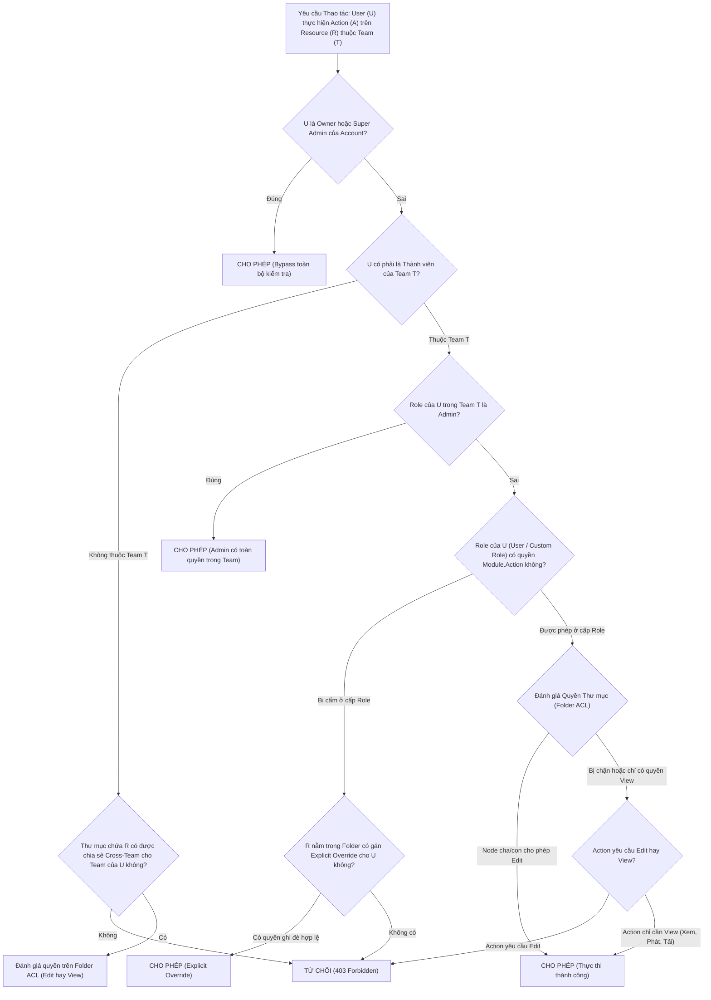

# Concept: SCIO Access Control, Roles & Resource Governance Architecture (Brief B)

## 1. Problem & Goal (Vấn đề & Mục tiêu)

### Problem (Điểm nghẽn & Thách thức kỹ thuật)
- **Context & Trigger**: Khách hàng doanh nghiệp quản lý mạng lưới hàng trăm màn hình kỹ thuật số (Digital Signage) trải dài qua nhiều chi nhánh và phòng ban. Quản trị viên cần phân quyền vận hành độc lập cho từng nhóm nhân viên (Marketing, Vận hành, Bán lẻ) trên các nhóm màn hình và kho tệp tin khác nhau.
- **Symptom & Defect**: 
  - Thiếu ranh giới phân quyền đa tầng dẫn đến nguy cơ rò rỉ hoặc can thiệp chéo: nhân viên chi nhánh A có thể sửa màn hình của chi nhánh B, hoặc phát nhầm tài liệu chưa kiểm duyệt lên màn hình sảnh chính.
  - Phân quyền phẳng (chỉ gán role tĩnh ở cấp tài khoản) không đáp ứng được nghiệp vụ thực tế: người dùng cần quyền `Edit` trên một số thư mục màn hình cụ thể, nhưng chỉ được quyền `View` trên các thư mục tài sản thương hiệu dùng chung.
- **Root Cause**: Thiếu kiến trúc phân quyền kết hợp giữa vai trò danh tính (**Dual-Scope RBAC**: Account vs Team) và danh sách kiểm soát truy cập tài nguyên phân cấp (**Hierarchical Folder ACL**).
- **Impact / Blast Radius**: Nguy cơ hiển thị sai nội dung tại các điểm công cộng gây khủng hoảng truyền thông; mất an toàn thông tin nội bộ; xung đột dữ liệu giữa các phòng ban.

### Goal (Kết quả kỹ thuật mục tiêu)
- **Core Goal**: Thiết kế kiến trúc giải pháp phân quyền và quản trị tài nguyên (Assets & Screens) hoàn chỉnh từ con số 0 cho nền tảng SCIO, tập trung giải quyết bài toán cốt tử: **"Ai được phép làm gì trên những màn hình và tệp tin nào"**.
- **Acceptance Criteria**:
  - **Mô hình Định danh 2 Tầng (Account Scope vs Team Scope)**:
    - *Account Scope*: `Owner` (chủ sở hữu tài khoản, quản lý gói dịch vụ và thanh toán) và `Super Admin` (toàn quyền quản trị trên TẤT CẢ các Teams/Workspaces trong tổ chức).
    - *Team Scope*: Mỗi Team là một workspace độc lập (có `screen_limit` riêng, danh sách thành viên riêng). Hỗ trợ các vai trò: `Admin`, `User`, `Read Only` và các `Custom Role` do người dùng tự tạo.
  - **Bộ máy Phân quyền Tùy biến (Custom Role Engine)**:
    - Cho phép tạo vai trò mới dựa trên ma trận quyền hạn theo 4 module (`Screens`, `Files/Assets`, `Playlists`, `Schedules`) $\times$ 4 hành động (`Create`, `Edit`, `Delete`, `Tags`).
    - Loại trừ 2 vai trò `Content Proposal` và `Content Approval` theo đúng yêu cầu đề bài.
  - **Kiểm soát Truy cập Thư mục Phân tầng (Folder ACL Security)**:
    - Hỗ trợ cây thư mục lồng nhau dùng chung cho cả Assets và Screens.
    - Chia sẻ thư mục linh hoạt: chia sẻ cho `Everyone on this team`, chia sẻ cho `Specific Users`, hoặc chia sẻ dùng chung giữa các Team (`Cross-Team Sharing`).
    - 2 cấp độ quyền tài nguyên chuẩn hóa: **`Edit`** (toàn quyền tải lên, sửa đổi, thay thế, xóa) và **`View`** (chỉ đọc, xem trước, tải về, và gán phát sóng).
  - **Quy tắc Phân quyền Liên kết (Cross-Resource Action: Screen $\times$ Asset)**:
    - Định nghĩa rõ quy tắc khi gán tệp vào màn hình: User chỉ cần quyền **`Edit` trên Screen** và quyền **`View` trên Asset** là đủ điều kiện gán phát nội dung.
  - **Cơ chế Ghi đè Quyền (Explicit Override & Conflict Resolution)**:
    - Quyền gán trực tiếp tại thư mục con ghi đè quyền kế thừa từ thư mục cha (*Most Specific Wins*).
    - Hiển thị hộp thoại cảnh báo bảo mật khi việc gán quyền thư mục con vượt trần vai trò mặc định của thành viên trong Team.

---

## 2. Scope Boundaries (Ranh giới phạm vi)

### In-Scope (Trọng tâm cốt lõi - Quyền & Vai trò)
1. **Quản trị Tổ chức & Không gian làm việc (Account & Teams)**:
   - Mô hình phân cấp: Account $\to$ Workspaces (Teams).
   - Quản trị Team: Tạo team mới, cấu hình hạn ngạch màn hình (`Number of screens limit`), kiểm tra hạn ngạch khả dụng (`X screens are available`).
   - Quản trị Thành viên: Mời thành viên qua email (`Invite User`), đổi vai trò (`Change Role`), gỡ khỏi Team (`Remove Member from Team`), xóa vĩnh viễn khỏi tổ chức (`Delete User from Account`).
2. **Hệ thống Vai trò & Phân quyền (Roles & Permissions)**:
   - 5 Vai trò hệ thống mặc định: `Owner`, `Super Admin`, `Admin`, `User`, `Read Only`.
   - Engine tạo Custom Role: Ma trận cấp phép linh hoạt trên 4 module và 4 hành động.
3. **Cơ chế Kiểm soát Thư mục (Folder ACL Engine)**:
   - Cấu trúc phân cấp kế thừa quyền (Inherited Permissions) và ngắt kế thừa (Break Inheritance / Explicit Override).
   - Đối tượng chia sẻ: Cấp Team hoặc User cụ thể với 2 mức quyền: `Edit` và `View`.
4. **Mô hình hóa Màn hình & Tài sản (Resource Modeling for Authorization)**:
   - *Assets*: Quản lý metadata, gắn thư mục, kiểm soát hạn ngạch lưu trữ, chia sẻ thư mục (`Shared with me`). Thao tác Replace, Delete, Download được bảo vệ bằng quyền `Edit`/`View`.
   - *Screens*: Ghép nối thiết bị bằng mã 6 ký tự (`Pair code *`), gắn thư mục màn hình, thực thi hạn ngạch `screen_limit` theo Team, và kiểm soát quyền gán nội dung.
5. **Động cơ Đánh giá Quyền Tốc độ cao (Authorization Evaluation Engine)**:
   - Thuật toán thác đổ ngắn mạch (Short-circuit Waterfall) đánh giá quyền truy cập trong thời gian < 5ms.

### Explicit Out-of-Scope (Chủ động loại trừ để giữ đúng trọng tâm Đề B)
- ❌ **Device Player Runtime & Video Decoding**: Không lập trình ứng dụng phát media trên thiết bị phần cứng (Android/FireStick/Tizen).
- ❌ **Playback Scheduling & Playlist Recurrence Engine**: Không xây dựng logic lập lịch phát sóng lịch biểu lặp lại theo tuần/tháng (thuộc phạm vi Đề A).
- ❌ **Content Proposal & Approval Workflow**: Chủ động loại trừ 2 vai trò này theo ràng buộc đề bài Brief B.
- ❌ **Chi tiết Trình biên tập Media (Media Editor / Canvas)**: Không thiết kế các công cụ chỉnh sửa hình ảnh, ghép chữ trực tiếp trên portal.

---

## 3. Proposed Solution & Core Mechanism (Giải pháp đề xuất & Cơ chế cốt lõi)

### 3.1 Mô hình Kiến trúc Phân quyền Đa tầng (Dual-Layer Authorization Model)

Hệ thống kết hợp 2 lớp phòng thủ độc lập:
1. **Lớp 1 (Coarse-Grained / Functional RBAC)**: Xác định người dùng có được phép thực hiện loại hành vi đó trong hệ thống hay không (dựa trên vai trò Account/Team và Ma trận Custom Role).
2. **Lớp 2 (Fine-Grained / Resource Folder ACL)**: Xác định người dùng có quyền trên đúng đối tượng tài nguyên cụ thể đó hay không (dựa trên cây thư mục phân cấp chứa tài nguyên).

```
┌──────────────────────────────────────────────────────────────────────────────────┐
│                             ACCOUNT TENANT SCOPE                                 │
│  • Owner: Chủ tài khoản, thanh toán, toàn quyền.                                 │
│  • Super Admin: Quản trị viên cấp cao, toàn quyền trên TẤT CẢ các Team.          │
└──────────────────────────────────────┬───────────────────────────────────────────┘
                                       │
        ┌──────────────────────────────┴──────────────────────────────┐
        ▼                                                             ▼
┌─────────────────────────────────┐           ┌─────────────────────────────────┐
│     TEAM A (Marketing Store 1)  │           │     TEAM B (Logistics HQ)       │
│  • screen_limit: 15 screens     │           │  • screen_limit: 5 screens      │
│  • Team Members:                │           │  • Team Members:                │
│    - Admin (Quản trị Team A)    │           │    - Admin (Quản trị Team B)    │
│    - User (Nhân viên tạo tệp)   │           │    - Read Only (Chỉ xem)        │
│    - Custom Role (Screen Ops)   │           │                                 │
│  ─────────────────────────────  │           │  ─────────────────────────────  │
│  • Resource Tree:               │           │  • Resource Tree:               │
│    ├─ Screens: /Store1/Entrance │           │    ├─ Screens: /Warehouse/Gate  │
│    └─ Assets: /Promotions/Q4    │           │    └─ Assets: /SOP/Safety       │
└─────────────────────────────────┘           └─────────────────────────────────┘
```

---

### 3.2 Thuật toán Đánh giá Phân quyền Ngắn mạch (Waterfall Permission Flow)

Mỗi khi người dùng thực hiện hành động trên một tài nguyên (Screen hoặc Asset), hệ thống áp dụng thuật toán thác đổ đánh giá theo thứ tự ưu tiên:



---

### 3.3 Ma trận Phân quyền Liên kết Cốt lõi (Cross-Resource Resolution)

Để trả lời câu hỏi cốt tử của đề bài: **"Ai được phép làm gì trên những màn hình và tệp tin nào"**:

| Hành vi Nghiệp vụ (Action) | Quyền bắt buộc trên Screen | Quyền bắt buộc trên Asset | Ràng buộc Thẩm quyền bổ sung |
| :--- | :---: | :---: | :--- |
| **Gán tệp lên Màn hình (Assign Content)** | **`Edit`** (trên Screen hoặc Folder Screen) | **`View`** (trên Asset hoặc Folder Asset) | User chỉ cần quyền xem tệp để chiếu lên màn hình mà mình quản lý. |
| **Ghép nối Màn hình mới (Pair Screen)** | *(Chưa tồn tại)* | Không yêu cầu | User phải có quyền `Screens.Create` VÀ Team còn hạn ngạch (`screens_used < screen_limit`). |
| **Thay thế tệp tin (Replace Asset)** | Không yêu cầu | **`Edit`** (trên Asset) | Giữ nguyên Asset ID; các màn hình đang phát tự động nhận bản mới. |
| **Đổi vai trò thành viên (Change Role)** | Không yêu cầu | Không yêu cầu | Chỉ `Owner`, `Super Admin`, hoặc `Admin` của Team (không được nâng role vượt trần của mình). |
| **Chia sẻ Thư mục (Share Folder ACL)** | **`Manage / Admin`** trên Folder | **`Manage / Admin`** trên Folder | Chỉ chủ sở hữu thư mục hoặc người có quyền Admin mới được cấp quyền tiếp cho người khác. |

---

### 3.4 Wireframe Giao diện Khái niệm (ASCII UI Wireframes)

#### 1. Trung tâm Quản trị Thành viên & Không gian làm việc (`/app/s/account-members`)
```
+--------------------------------------------------------------------------------------------------+
| OPTISIGNS SCIO  │  [Store 1 - Marketing v]  │  Account Members (Unified Workspace)  │  [User: Kiem v]   |
+--------------------------------------------------------------------------------------------------+
| TEAMS / WORKSPACES                              │ MEMBERS IN: Store 1 - Marketing                        |
| + Add Team  [Search team...]                    │ [+ Add New User]  [Invite Member]  [x] Show All Members|
| ----------------------------------------------- │ ------------------------------------------------------ |
| * Store 1 - Marketing (12/15 screens) [Selected]│ Name / Email           Role        Status   Actions    |
|   Store 2 - Retail    (8/10 screens)            │ ------------------------------------------------------ |
|   HQ - Logistics      (3/5 screens)             │ Nguyen Ha Anh Kiem     Owner       Active   [-] [P]    |
|                                                 │ Sarah Jenkins          Admin       Active   [K] [P] [X]|
|                                                 │ David Chen             User        Active   [K] [P] [X]|
| Total Account Quota: 23 / 30 screens used       │ Emma Watson            Read Only   Pending  [K] [P] [X]|
| Available to allocate: 7 screens                │ Alex Morgan            Screen-Ops  Active   [K] [P] [X]|
+--------------------------------------------------------------------------------------------------+
| [Legend Actions: [K] Reset Password  |  [P] Change Role  |  [X] Remove from Team  |  [-] Protected]       |
+--------------------------------------------------------------------------------------------------+
```

#### 2. Ma trận Tạo Vai trò Tùy biến (`Manage Roles -> + New Role Modal`)
```
+--------------------------------------------------------------------------------------------------+
| Create Custom Role                                                                           [X] |
+--------------------------------------------------------------------------------------------------+
| Role Name *: [ Screen Operator Tier 1                        ]                                   |
| Description: [ Chỉ cho phép quản lý màn hình và xem tệp tin, cấm chỉnh sửa tệp nội dung        ] |
|                                                                                                  |
| MODULE PERMISSIONS MATRIX                                                                        |
| ------------------------------------------------------------------------------------------------ |
| Module Name          Create          Edit            Delete          Manage Tags                 |
| ------------------------------------------------------------------------------------------------ |
| Screens             [ON ]           [ON ]           [OFF]           [ON ]                       |
| Files / Assets      [OFF]           [OFF]           [OFF]           [OFF] (Chỉ có quyền View)   |
| Playlists           [ON ]           [ON ]           [OFF]           [ON ]                       |
| Schedules           [OFF]           [OFF]           [OFF]           (N/A)                       |
| ------------------------------------------------------------------------------------------------ |
| [Cancel]                                                                     [Save Custom Role]  |
+--------------------------------------------------------------------------------------------------+
```

#### 3. Hộp thoại Phân quyền Thư mục Phân tầng (`Folder Security ACL Modal`)
```
+--------------------------------------------------------------------------------------------------+
| Security: Select users and teams that can access this folder                                 [X] |
+--------------------------------------------------------------------------------------------------+
| Folder: /Promotions/Q4_Holiday_Campaign                                                          |
| Inherit permissions from parent (/Promotions): [ON] (Enabled)                                    |
|                                                                                                  |
| ACCESS LIST                                                          Add: [Select User / Team v] |
| ------------------------------------------------------------------------------------------------ |
| Entity (User / Team)                 Type        Permission Level        Status / Source         |
| ------------------------------------------------------------------------------------------------ |
| Store 1 - Marketing (Team)           Team        [Edit        v]         Inherited from root     |
| Everyone on Store 2 (Retail)         Team        [View Only   v]         Direct Share            |
| Alex Morgan (Screen-Ops)             User        [Edit        v]         Explicit Override (!)   |
|                                                                                                  |
| (!) WARNING: Alex Morgan has 'User' role in Team. Granting 'Edit' here elevates privileges       |
|     for this specific folder only. Confirm override? [x] Yes, allow explicit override.           |
| ------------------------------------------------------------------------------------------------ |
| [Cancel]                                                                  [Apply Permission]     |
+--------------------------------------------------------------------------------------------------+
```

---

## 4. Critical Risks & Edge Cases (Phân tích Rủi ro & Cơ chế Phòng vệ)

1. **Rủi ro Nâng quyền Trái phép qua Thư mục (Privilege Escalation via Folder ACL)**:
   - *Nguy cơ*: Một User cấp thấp (chỉ có quyền Read Only) được ai đó vô tình thêm quyền `Edit` trên một thư mục cha, vô tình cấp quyền sửa toàn bộ cây thư mục con.
   - *Phòng vệ*: Hệ thống thực thi **Dual-Gate Check**: Khi gán quyền thư mục con vượt trần vai trò thành viên, bắt buộc hiển thị hộp thoại cảnh báo xác nhận (*Elevated Privilege Warning Modal*). Đồng thời, hành động này được ghi nhận ngay vào bảng `audit_logs` có đánh cờ `is_elevated_override: true`.
2. **Rủi ro Mồ côi Chủ sở hữu (Orphaned Account / Last-Owner Problem)**:
   - *Nguy cơ*: Thành viên mang vai trò `Owner` duy nhất bị xóa khỏi hệ thống hoặc tự hạ vai trò, khiến tài khoản doanh nghiệp không còn ai có quyền quản trị gói cước.
   - *Phòng vệ*: Quy tắc bất biến cấp cơ sở dữ liệu (**Last-Owner Protection Invariant**): Không cho phép hạ quyền, rời team hoặc xóa tài khoản của người dùng `Owner` khi chưa thực hiện chuyển giao quyền sở hữu (*Transfer Ownership*) cho một người dùng khác.
3. **Rủi ro Trễ đồng bộ Bộ đệm Phân quyền (Permission Cache Invalidation)**:
   - *Nguy cơ*: Khi Admin vừa thu hồi quyền của User trên một thư mục, nhưng User vẫn thực hiện được thao tác do token hoặc cache Redis còn hiệu lực.
   - *Phòng vệ*: Áp dụng cơ chế **Versioned Policy Tag**: Mỗi Team và Thư mục có một trường `permission_version` (tự động tăng khi có thay đổi ACL). Token mang theo version này; khi phát hiện lệch version, backend truy vấn kiểm tra quyền trực tiếp tại cơ sở dữ liệu thay vì dùng cache.
4. **Rủi ro Race Condition khi ghép nối màn hình vượt hạn ngạch (Screen Quota Overflow)**:
   - *Nguy cơ*: Hai Admin cùng nhập mã pairing code ở hai chi nhánh khác nhau tại cùng một giây khi Team chỉ còn 1 license trống.
   - *Phòng vệ*: Sử dụng truy vấn cập nhật nguyên tử có điều kiện khóa dòng (*Atomic Lock*):
     `UPDATE teams SET used_screens = used_screens + 1 WHERE id = :teamId AND used_screens < screen_limit;`
     Nếu số dòng ảnh hưởng = 0, giao dịch bị hủy ngay lập tức với mã lỗi `409 Quota Exceeded`.
