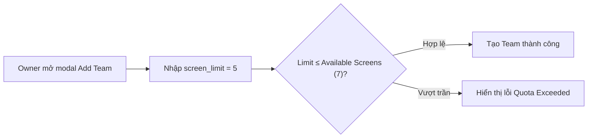
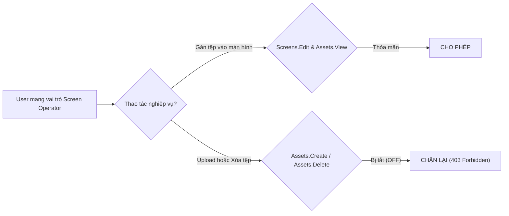
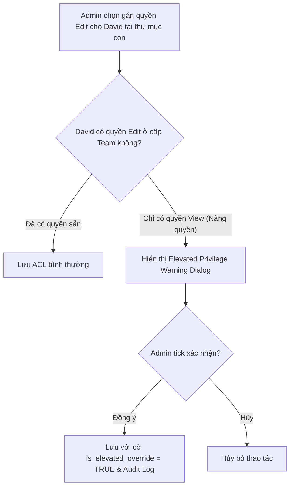

# Plan: SCIO Access Control, Dynamic Roles & Resource Governance Implementation (Brief B)

Tài liệu này là bản kế hoạch kỹ thuật chi tiết (Implementation Blueprint) chuyển hóa toàn bộ đặc tả kiến trúc từ `concept.md` thành lộ trình thực thi theo 6 Sprints (12 tuần). Bản kế hoạch được thiết kế cho đội ngũ kỹ thuật gồm **1 Senior Backend Engineer, 1 Senior Frontend Engineer và 0.5 QA Engineer** triển khai từ con số 0.

---

## Section 1. Directory Structure Blueprint (Kiến trúc Cây Thư mục Mã nguồn)

Dưới đây là cấu trúc module của phân hệ SCIO Brief B dự kiến xây dựng trên nền tảng **NestJS (Backend)** và **Next.js 15 App Router (Frontend)**:

```text
scio-portal/
├── backend/src/modules/
│   ├── [NEW] identity/                      # Tầng định danh đa người thuê (Tenant & Identity)
│   │   ├── entities/
│   │   │   ├── account.entity.ts            # Thực thể Account (gói cước, tổng quota màn hình)
│   │   │   ├── team.entity.ts               # Thực thể Team / Workspace (screen_limit)
│   │   │   └── user.entity.ts               # Thực thể User (account_role: owner, super_admin)
│   │   ├── guards/
│   │   │   ├── tenant-context.guard.ts      # Middleware giải nén Account & Team context từ JWT
│   │   │   └── super-admin.guard.ts         # Guard kiểm tra quyền Super Admin / Owner cấp Account
│   │   └── identity.service.ts              # Dịch vụ quản trị thành viên, mời user, chuyển team
│   ├── [NEW] access-control/                # Bộ máy phân quyền động (Dual-Scope RBAC & Roles)
│   │   ├── entities/
│   │   │   ├── role.entity.ts               # Thực thể Role (5 System Roles + Custom Roles)
│   │   │   └── role-permission.entity.ts    # Ma trận quyền 4 Module x 4 Switches
│   │   ├── decorators/
│   │   │   └── require-permissions.decorator.ts # Decorator khai báo quyền: @RequirePermissions()
│   │   ├── guards/
│   │   │   └── permissions.guard.ts         # Execution Guard đánh giá quyền trước khi vào Handler
│   │   └── access-control.service.ts        # Quản trị CRUD Role, Seed 5 vai trò hệ thống
│   ├── [NEW] folders/                       # Động cơ Cây Thư mục Phân cấp (Dùng chung Screen & Asset)
│   │   ├── entities/
│   │   │   ├── folder.entity.ts             # Thực thể Folder sử dụng PostgreSQL ltree (path)
│   │   │   └── folder-share.entity.ts       # Bảng ACL chia sẻ: Team/User x Edit/View
│   │   ├── folder-acl.evaluator.ts          # Thuật toán thác đổ ltree tìm node hiệu lực < 5ms
│   │   └── folders.service.ts               # Thao tác thư mục (CRUD, Move To, Share, Override)
│   ├── [NEW] assets/                        # Quản trị Tệp tin Tải lên (Assets Governance)
│   │   ├── entities/asset.entity.ts         # Thực thể Asset (Metadata, Storage Key, Mime-type)
│   │   ├── services/
│   │   │   ├── s3-storage.service.ts        # Ký Pre-signed URL upload trực tiếp Cloud Storage
│   │   │   └── asset-lifecycle.service.ts   # Replace giữ ID, Clone, Download, Soft-delete
│   │   └── assets.controller.ts             # API kiểm soát bằng Folder ACL (@CanView / @CanEdit)
│   ├── [NEW] screens/                       # Quản trị Hạm đội Màn hình (Screens Fleet Governance)
│   │   ├── entities/screen.entity.ts        # Thực thể Screen (Pair code, Folder, Assigned Content)
│   │   ├── pairing.service.ts               # Xác thực mã ghép nối 6 ký tự, Atomic Quota Lock
│   │   └── screens.controller.ts            # API quản lý màn hình, gán thư mục, gán nội dung
│   └── [NEW] audit/                         # Đường ống Kiểm toán Bảo mật (Security Audit Trail)
│       ├── entities/audit-log.entity.ts     # Thực thể Audit Log (Actor, Action, Resource, Diff)
│       └── audit.interceptor.ts             # Interceptor tự động ghi log bất đồng bộ
└── frontend/src/app/
    ├── [NEW] (dashboard)/s/account-members/ # Trang hợp nhất Quản trị Nhóm & Thành viên
    │   ├── page.tsx                         # Single-pane layout: Sidebar Teams + Bảng Members
    │   └── components/
    │       ├── AddTeamModal.tsx             # Modal thêm Team, spinner screen_limit
    │       ├── ManageRolesModal.tsx         # Modal xem 5 System Roles & nút tạo Custom Role
    │       ├── CreateRoleModal.tsx          # Ma trận switch 4 Module x 4 Action
    │       └── ManageMembersModal.tsx       # Bảng thành viên kèm 4 nút thao tác chuẩn
    ├── [NEW] (dashboard)/screenManagement/  # Quản trị Màn hình & Cây Thư mục Màn hình
    │   └── components/PairScreenModal.tsx   # Modal ghép nối màn hình mã 6 ký tự
    └── [NEW] (dashboard)/assetManagement/   # Quản trị Tệp tin & Cây Thư mục Tài sản
        └── components/FolderSecurityModal.tsx # Modal phân quyền thư mục (Edit / View / Override)
```

---

## Section 2. Story Board (User Journey & BDD Feature Scenarios)

### Story 1: Phân bổ Hạn ngạch Màn hình theo Không gian làm việc (Team Screen Quota)
- **User Story**: Là một **Account Owner**, tôi muốn tạo một Team mới và chỉ định hạn ngạch màn hình (`Number of screens limit`) để các phòng ban không thể ghép nối vượt quá số lượng màn hình doanh nghiệp đã mua.
- **Before**: Không có giới hạn theo Team; một chi nhánh có thể ghép nối hết toàn bộ license màn hình của toàn công ty.
- **After**: Mỗi Team có trần license độc lập; hệ thống hiển thị số lượng còn lại (`X screens are available`) và ngăn chặn tức thì khi vượt trần.
- **Key Scenarios**:
  - *Scenario 1 (Happy Path - Cấp phát hợp lệ)*:
    - **Given**: Account có 30 license màn hình, hiện đang dùng 23 license (còn 7 license khả dụng).
    - **When**: Owner mở modal `+ Add Team`, nhập tên `"Store 3"` và `screen_limit = 5`.
    - **Then**: Hệ thống tạo Team thành công, số license còn khả dụng của Account giảm xuống 2.
  - *Scenario 2 (Boundary Case - Cấp phát vượt trần khả dụng)*:
    - **Given**: Account chỉ còn 7 license khả dụng.
    - **When**: Owner cố gắng tạo Team mới với `screen_limit = 8`.
    - **Then**: Giao diện vô hiệu hóa nút Lưu và hiển thị lỗi: `"Limit exceeds available account quota (7 screens left)"`.



---

### Story 2: Tạo Vai trò Tùy biến theo Ma trận Module (Custom Role Matrix)
- **User Story**: Là một **Super Admin**, tôi muốn tạo một vai trò mới `"Screen Operator"` chỉ được phép xem tệp tin và chỉnh sửa màn hình, không được phép tải lên hoặc xóa tài sản của công ty.
- **Before**: Chỉ có các vai trò tĩnh; nhân viên vận hành màn hình phải được cấp vai trò `Admin` (quá nhiều quyền nguy hiểm) hoặc `User` (vẫn sửa được tệp tin).
- **After**: Super Admin tạo Custom Role với ma trận: Screens (`Create=ON, Edit=ON, Delete=OFF`), Assets (`Create=OFF, Edit=OFF, Delete=OFF, View=ON`).
- **Key Scenarios**:
  - *Scenario 1 (Happy Path - Hoạt động đúng ma trận)*:
    - **Given**: User `Alex` được gán vai trò `Screen Operator`.
    - **When**: Alex thực hiện gán video có sẵn vào màn hình sảnh.
    - **Then**: Yêu cầu được chấp thuận vì quyền gán chỉ đòi hỏi `Screens.Edit` và `Assets.View`.
  - *Scenario 2 (Security Boundary - Vi phạm ma trận)*:
    - **Given**: User `Alex` đang ở trang Files/Assets.
    - **When**: Alex cố gắng bấm nút `Upload Files` hoặc `Delete Asset`.
    - **Then**: Nút bấm bị ẩn/vô hiệu hóa trên UI; nếu gửi API request trực tiếp sẽ nhận mã lỗi `403 Forbidden`.



---

### Story 3: Phân quyền Thư mục Phân tầng & Cảnh báo Nâng quyền (Folder ACL & Explicit Override)
- **User Story**: Là một **Team Admin**, tôi muốn chia sẻ một thư mục con chứa tài liệu chiến dịch cho một nhân viên `User` với quyền `Edit`, nhưng hệ thống phải cảnh báo nếu thao tác này nâng quyền của nhân viên đó.
- **Before**: Quyền được kế thừa mù quáng từ thư mục cha; không có cơ chế cảnh báo khi phân quyền vượt trần vai trò thành viên.
- **After**: Cho phép gán quyền ghi đè (*Explicit Override*) tại thư mục con nhưng bắt buộc hiển thị hộp thoại cảnh báo nâng quyền (*Elevated Privilege Warning Modal*).
- **Key Scenarios**:
  - *Scenario 1 (Happy Path - Cảnh báo và xác nhận override)*:
    - **Given**: Thư mục `/Promotions` kế thừa quyền từ Team (User `David` chỉ có quyền `View`).
    - **When**: Admin mở hộp thoại Security của thư mục `/Promotions/Q4_Flash_Sale` và chọn gán David quyền `Edit`.
    - **Then**: Giao diện hiển thị cảnh báo: *"David chỉ có quyền View ở cấp Team. Gán Edit tại đây sẽ nâng quyền thao tác trên thư mục này. Xác nhận?"*. Khi Admin tick chọn xác nhận, quyền ghi đè được lưu thành công.
  - *Scenario 2 (Resolution - Node gần nhất thắng)*:
    - **Given**: David có quyền `Edit` tại node con `/Promotions/Q4_Flash_Sale` nhưng chỉ có `View` tại node cha `/Promotions`.
    - **When**: David tải file lên `/Promotions/Q4_Flash_Sale`.
    - **Then**: Backend sử dụng `ltree` tìm thấy node con có `permission_level = edit` ở độ sâu cao nhất và cho phép thực thi.



---

## Section 3. Test Cases & Verification Matrix (Ma trận Kiểm thử & Nghiệm thu)

### 3.1 Test Case Specification Matrix (25 Test Cases Toàn diện trên 6 Phân hệ)

Dưới đây là ma trận 25 ca kiểm thử BDD bao phủ toàn bộ phạm vi Brief B từ tầng Định danh, Phân quyền, Thư mục, Quản trị Tài nguyên đến Kiểm toán:

| Test ID | Phân hệ (Module) | Kịch bản Kiểm thử (Test Scenario) | Dữ liệu Đầu vào (Fixture / Inputs) | Kết quả Mong đợi (Expected Outcome) |
| :--- | :--- | :--- | :--- | :--- |
| **TC-IDN-01** | Identity / Tenant | Super Admin truy cập tài nguyên của bất kỳ Team nào | Token của `Super Admin`, `team_id = Team B` | HTTP 200 OK; bỏ qua toàn bộ kiểm tra thành viên Team (`Bypass Gate`). |
| **TC-IDN-02** | Identity / Tenant | User truy cập dữ liệu Team mà mình không phải thành viên | Token của `User A` (Team A), gửi request lấy màn hình Team B | HTTP 403 Forbidden: `"Tenant boundary violation"`. |
| **TC-IDN-03** | Identity / Tenant | Xóa hoặc hạ quyền tài khoản Owner duy nhất của Account | Request hạ role của Owner cuối cùng hoặc `DELETE /users/:id` | HTTP 400 Bad Request: `"Cannot remove the last Account Owner"`. |
| **TC-IDN-04** | Identity / Tenant | Phân biệt Gỡ khỏi Team (`Remove`) vs Xóa khỏi Account (`Delete`) | Thao tác `Remove Member` từ Team A | User bị xóa khỏi Team A nhưng tài khoản và quyền tại Team B vẫn nguyên vẹn. |
| **TC-ROL-05** | Access Control | Bảo vệ tính bất biến của 5 System Roles | Request sửa quyền hoặc xóa role `Admin` hoặc `Read Only` | HTTP 403 Forbidden: `"System roles are immutable and cannot be modified"`. |
| **TC-ROL-06** | Access Control | Tạo Custom Role thành công với ma trận 4x4 hợp lệ | Payload gồm 4 module x 4 switches (Screens, Assets, Playlists, Schedules) | HTTP 201 Created; lưu chính xác các cờ boolean vào `role_module_permissions`. |
| **TC-ROL-07** | Access Control | Custom Role cấm tạo màn hình gửi request ghép nối | User có Custom Role với `screens.can_create = false` | HTTP 403 Forbidden: `"Action 'screens.create' is denied by assigned role"`. |
| **TC-ROL-08** | Access Control | Chống nâng quyền: Team Admin cố tình cấp role `Super Admin` | Token của `Team Admin`, payload invite user với `role = super_admin` | HTTP 403 Forbidden: `"Cannot assign role higher than caller's tenant scope"`. |
| **TC-FLD-09** | Folder ACL | Kế thừa quyền đọc (`View`) từ thư mục cha xuống thư mục con | Thư mục `/Brand` share `view` cho Team A; truy cập file ở `/Brand/Logos/2026` | Trả về `permission_level = view` qua `ltree` GiST path lookup (< 5ms). |
| **TC-FLD-10** | Folder ACL | Ghi đè quyền (`Explicit Override`) tại thư mục con | Cha `/Brand` có quyền `view`; Con `/Brand/Scratch` gán `edit` cho User C | User C tải file lên thư mục con thành công (Node gần nhất thắng). |
| **TC-FLD-11** | Folder ACL | Ngắt kế thừa quyền (`Break Inheritance`) | Bật cờ `inherit_permissions = false` tại thư mục con `/Private` | Thành viên có quyền ở thư mục cha bị chặn truy cập hoàn toàn vào thư mục con. |
| **TC-FLD-12** | Folder ACL | Kích hoạt cảnh báo nâng quyền khi chia sẻ thư mục con | User chỉ có quyền `Read Only` ở Team, Admin chọn cấp quyền `Edit` tại thư mục | API trả về flag `requires_privilege_elevation_warning: true` và yêu cầu xác nhận. |
| **TC-FLD-13** | Folder ACL | Chia sẻ thư mục liên Team (Cross-Team Folder Sharing) | Team Marketing chia sẻ thư mục `/Assets/Promotions` cho Team Retail với `view` | Thành viên Team Retail nhìn thấy thư mục trong tab `Shared with me` và dùng được. |
| **TC-AST-14** | Assets Subsystem | Kiểm soát hạn ngạch lưu trữ trước khi cấp Pre-signed URL | Account còn 10MB trống, User yêu cầu upload file video 50MB | HTTP 413 Payload Too Large: `"Storage quota exceeded (10MB remaining)"`. |
| **TC-AST-15** | Assets Subsystem | Thay thế tệp tin giữ nguyên ID (`Replace Asset`) | Upload file mới thay thế cho file cũ có `asset_id = UUID_X` | File mới được lưu vào S3; `asset_id` giữ nguyên; các màn hình đang chiếu không bị đổi ID. |
| **TC-AST-16** | Assets Subsystem | Thao tác Tải xuống (`Download`) yêu cầu tối thiểu quyền `View` | User có quyền `View` trên thư mục bấm tải file gốc | Backend tạo temporary S3 signed download URL với hạn 15 phút thành công. |
| **TC-AST-17** | Assets Subsystem | Thao tác Xóa tệp tin (`Delete Asset`) yêu cầu quyền `Edit` | User chỉ có quyền `View` gửi request `DELETE /assets/:id` | HTTP 403 Forbidden; bản ghi trong CSDL không bị đánh dấu `is_deleted`. |
| **TC-SCR-18** | Screen Fleet | Ghép nối màn hình mã 6 ký tự chuẩn | Nhập mã hợp lệ `"AB12CD"` hoặc bật checkbox chữ thường `"ab12cd"` | Màn hình chuyển trạng thái `pairing_status = paired`, gán vào Team của User. |
| **TC-SCR-19** | Screen Fleet | Ghép nối thất bại khi Team chạm trần hạn ngạch `screen_limit` | Team có `screen_limit = 10`, hiện đã ghép nối 10 màn hình | HTTP 409 Conflict: `"Screen limit reached for this team (10/10)"`. |
| **TC-SCR-20** | Screen Fleet | Khóa nguyên tử chống Race Condition khi nhiều admin ghép nối | 10 request ghép nối gửi đồng thời vào cùng 1 mili-giây khi còn 1 slot trống | Đúng 1 request thành công (201 Created), 9 request nhận 409 Conflict; DB không bị vượt trần. |
| **TC-SCR-21** | Screen Fleet | Quản lý thư mục màn hình phân cấp theo Chi nhánh | Màn hình được gán vào `/North/Hanoi/Store1` | Phân quyền truy cập màn hình tuân thủ theo cây thư mục `folders (type='screen')`. |
| **TC-XRS-22** | Cross-Resource | Gán nội dung thành công khi có `Screen.Edit` và `Asset.View` | User có quyền sửa màn hình và chỉ có quyền xem video quảng cáo | HTTP 200 OK; màn hình cập nhật `assigned_content_id = asset_id`. |
| **TC-XRS-23** | Cross-Resource | Gán nội dung thất bại khi không có quyền xem Asset | User có quyền sửa màn hình nhưng Asset nằm trong thư mục private người khác | HTTP 403 Forbidden: `"Insufficient permissions on assigned asset"`. |
| **TC-AUD-24** | Security Audit | Ghi nhật ký đầy đủ khi đổi vai trò thành viên | Admin đổi role của User từ `User` sang `Admin` | Bản ghi `audit_logs` được tạo với `action = member.role_changed`, lưu IP và actor_id. |
| **TC-SEC-25** | Security Engine | Vô hiệu hóa quyền tức thì khi bị thu hồi (Versioned Policy Tag) | Admin thu hồi quyền của User trên thư mục, User thực hiện thao tác sau 1s | Thao tác bị chặn ngay lập tức do `permission_version` bị tăng, buộc kiểm tra lại CSDL. |

---

### 3.2 Runtime Sanity & Trial Execution Steps (Kịch bản Nghiệm thu Thực tế Đa tầng)

Phần này định nghĩa các kịch bản chạy thử nghiệm thu thực tế bằng cả **Frontend Browser (Playwright Web E2E)** và **Backend API Probing (Curl / Concurrency Burst)**.

---

#### Kịch bản Web / Frontend (Playwright Browser E2E Trials)

##### 🌐 Trial 1 [WEB]: Tạo Team & Kiểm tra Ràng buộc Hạn ngạch Màn hình
- **Target URL**: `http://localhost:3000/app/s/account-members`
- **Tài khoản thực hiện**: Đăng nhập với quyền `Owner`.
- **Các bước tương tác**:
  1. Điều hướng đến menu `Account Members`.
  2. Bấm nút `+ Add Team` (selector: `button[data-testid="add-team-btn"]`).
  3. Nhập trường `Name *` = `"Chi nhánh Đà Nẵng"`.
  4. Quan sát dòng chữ hiển thị hạn ngạch khả dụng (selector: `.text-muted-foreground`): verify hiển thị `"7 screens are available"`.
  5. Nhập `Number of screens limit` = `5`.
  6. Bấm nút `Save` (selector: `button[data-testid="save-team-btn"]`).
- **Xác thực kết quả & Ảnh chụp màn hình**:
  - Modal đóng lại; sidebar danh sách Team hiển thị thêm dòng `"Chi nhánh Đà Nẵng (0/5 screens)"`.
  - Dòng quota tổng của Account cập nhật: `"Available to allocate: 2 screens"`.
  - 📸 **Lưu ảnh chụp**: `docs/screenshots/verification/fe_01_team_quota_created.png`.
  - 0 lỗi đỏ xuất hiện trên DevTools Console (`console.error = 0`).

##### 🌐 Trial 2 [WEB]: Tạo Custom Role & Kiểm chứng Vô hiệu hóa Nút bấm trên UI
- **Target URL**: `http://localhost:3000/app/s/account-members`
- **Tài khoản thực hiện**: Đăng nhập với quyền `Super Admin`.
- **Các bước tương tác**:
  1. Bấm nút `Manage Roles` $\to$ Bấm `+ New Role`.
  2. Nhập `Role Name *` = `"Screen Operator Tier 1"`.
  3. Tại ma trận quyền: Bật toggle `Screens (Create, Edit)` sang `ON`; Tắt toàn bộ toggle của `Files/Assets` sang `OFF`.
  4. Bấm `Save Custom Role`. Gán role này cho nhân viên `Alex Morgan`.
  5. Đăng xuất và đăng nhập lại bằng tài khoản của `Alex Morgan`.
  6. Điều hướng đến trang quản trị tài sản: `http://localhost:3000/app/assetManagement`.
- **Xác thực kết quả & Ảnh chụp màn hình**:
  - Nút `Upload Files` (selector: `button[data-testid="upload-assets-btn"]`) bị **disabled** hoặc ẩn hoàn toàn.
  - Các icon thùng rác xóa tệp (selector: `.asset-delete-action`) không hiển thị trên danh sách tệp.
  - 📸 **Lưu ảnh chụp**: `docs/screenshots/verification/fe_02_custom_role_ui_disabled.png`.

##### 🌐 Trial 3 [WEB]: Phân quyền Thư mục & Hộp thoại Cảnh báo Nâng quyền (Elevated Warning)
- **Target URL**: `http://localhost:3000/app/assetManagement`
- **Tài khoản thực hiện**: Đăng nhập với quyền `Team Admin`.
- **Các bước tương tác**:
  1. Chuột phải vào thư mục con `/Campaigns/2026_Summer`.
  2. Chọn mục `Change Permission` từ context menu (selector: `div[role="menuitem"]:has-text("Change Permission")`).
  3. Trong modal Security, click chọn `Add User / Team` $\to$ Chọn nhân viên `David Chen` (đang có vai trò `Read Only` trong Team).
  4. Tại dropdown quyền hạn, chuyển từ `View` sang `Edit`.
- **Xác thực kết quả & Ảnh chụp màn hình**:
  - Giao diện lập tức xuất hiện khối thông báo cảnh báo màu vàng (Warning Alert):  
    *"(!) CẢNH BÁO: David Chen chỉ có quyền Read Only trong Team. Thao tác gán 'Edit' tại đây sẽ nâng quyền thao tác trên thư mục này. Bạn có chắc chắn muốn ghi đè?"*.
  - Nút `Apply Permission` bị vô hiệu hóa cho đến khi người dùng tick vào checkbox: `[x] Tôi xác nhận nâng quyền ghi đè (Explicit Override)`.
  - 📸 **Lưu ảnh chụp**: `docs/screenshots/verification/fe_03_elevated_warning_dialog.png`.

##### 🌐 Trial 4 [WEB]: Ghép nối Màn hình 6 ký tự & Toast Thông báo Chạm trần Hạn ngạch
- **Target URL**: `http://localhost:3000/app/screenManagement`
- **Tài khoản thực hiện**: Đăng nhập với quyền `Team Admin` tại Team đã dùng hết 10/10 license màn hình.
- **Các bước tương tác**:
  1. Bấm nút `Add Screen` (selector: `button[data-testid="add-screen-btn"]`).
  2. Modal `SCREEN - Add Screen` xuất hiện. Nhập `Pair code *` = `"xyz999"`.
  3. Tick chọn checkbox `"Use lowercase pairing code"`.
  4. Bấm nút `Pair`.
- **Xác thực kết quả & Ảnh chụp màn hình**:
  - Hệ thống hiển thị Toast thông báo lỗi màu đỏ ở góc phải màn hình:  
    *"Không thể ghép nối: Team này đã sử dụng hết hạn ngạch màn hình (10/10 screens limit). Vui lòng liên hệ Account Owner để nâng hạn ngạch."*.
  - Modal không bị crash, trường nhập mã vẫn giữ nguyên trạng thái để thử lại.
  - 📸 **Lưu ảnh chụp**: `docs/screenshots/verification/fe_04_pairing_quota_exceeded_toast.png`.

##### 🌐 Trial 5 [WEB]: Gán Tệp Tài sản vào Màn hình (Cross-Resource Action)
- **Target URL**: `http://localhost:3000/app/screenManagement`
- **Tài khoản thực hiện**: Đăng nhập với tài khoản `Screen Operator`.
- **Các bước tương tác**:
  1. Chọn màn hình `"Sảnh Tầng 1 - Kiosk A"`.
  2. Bấm nút `Set Content` $\to$ Chọn tab `Files/Assets`.
  3. Chọn tệp tin video `"Intro_OptiSigns_2026.mp4"` (thuộc thư mục chung được chia sẻ quyền `View`).
  4. Bấm `Save & Push to Screen`.
- **Xác thực kết quả & Ảnh chụp màn hình**:
  - Giao diện cập nhật trạng thái hiển thị của màn hình: `Current Content: Intro_OptiSigns_2026.mp4`.
  - Huy hiệu trạng thái chuyển sang màu xanh lá `"Active / Live"`.
  - 📸 **Lưu ảnh chụp**: `docs/screenshots/verification/fe_05_screen_assigned_success.png`.

---

#### Kịch bản Backend API & Concurrency Probing (Curl Runtime)

##### 🖥️ Trial 6 [API]: Kiểm tra Chặn quyền qua API Gateway (Zero BOLA / IDOR)
```bash
# 1. Thử nghiệm User bị cấm Delete cố tình gửi request xóa Asset qua API:
curl -s -o /dev/null -w "%{http_code}" -X DELETE \
  -H "Authorization: Bearer $OPERATOR_TOKEN" \
  http://localhost:3000/api/v1/assets/550e8400-e29b-41d4-a716-446655440000

# KẾT QUẢ MONG ĐỢI: 403 Forbidden
```

```bash
# 2. Thử nghiệm User có quyền View gán Asset vào Screen có quyền Edit:
curl -s -X POST \
  -H "Authorization: Bearer $OPERATOR_TOKEN" \
  -H "Content-Type: application/json" \
  -d '{"content_type": "asset", "content_id": "550e8400-e29b-41d4-a716-446655440000"}' \
  http://localhost:3000/api/v1/screens/6ba7b810-9dad-11d1-80b4-00c04fd430c8/assign

# KẾT QUẢ MONG ĐỢI:
# HTTP 200 {"success": true, "assigned_content_id": "550e8400-e29b-41d4-a716-446655440000"}
```

##### 🖥️ Trial 7 [API / Concurrency]: Kiểm tra Đua lệnh Ghép nối Màn hình (Atomic Quota Lock)
```bash
# Gửi đồng thời 10 luồng pairing trong cùng một mili-giây khi Team chỉ còn đúng 2 slot màn hình trống
seq 1 10 | xargs -n 1 -P 10 -I {} curl -s -o /dev/null -w "%{http_code}\n" -X POST \
  -H "Authorization: Bearer $ADMIN_TOKEN" \
  -H "Content-Type: application/json" \
  -d '{"pairing_code": "CODE_{}", "name": "Screen_{}"}' \
  http://localhost:3000/api/v1/screens/pair

# KẾT QUẢ MONG ĐỢI:
# Đúng 2 dòng trả về mã 201 Created.
# Đúng 8 dòng trả về mã 409 Conflict (Quota Exceeded).
# Truy vấn CSDL xác thực: SELECT count(*) FROM screens WHERE team_id = :teamId; -> Kết quả đúng bằng screen_limit.
```

---

## Section 4. Architectural Waves & Sprint Decomposition (Phân rã 6 Sprints)

### Wave 1 (Sprint 1 · Tuần 1-2): Nền tảng Định danh Đa người thuê & Quản trị Team
- **Mục tiêu**: Xây dựng hạ tầng cô lập dữ liệu theo Account và Workspaces (Teams), thiết lập 2 vai trò cấp cao (`Owner`, `Super Admin`) và giao diện Unified Workspace.
- **Nhiệm vụ chi tiết**:
  - `[BE-1.1]` Xây dựng cơ sở dữ liệu `accounts`, `teams`, `users`, `team_members` bằng PostgreSQL.
  - `[BE-1.2]` Triển khai `TenantContextMiddleware` giải nén `account_id` và `team_id` từ JWT token.
  - `[BE-1.3]` Xây dựng API quản lý hạn ngạch màn hình Team (`screen_limit`) và kiểm tra license còn lại của Account.
  - `[FE-1.4]` Xây dựng giao diện hợp nhất `/app/s/account-members` với bảng danh sách Teams bên trái và Members bên phải.
  - `[FE-1.5]` Modal `+ Add Team` với trường `Number of screens limit` và văn bản động `X screens are available`.

---

### Wave 2 (Sprint 2 · Tuần 3-4): Bộ máy Vai trò Động & Ma trận Custom Role
- **Mục tiêu**: Hoàn thiện 5 vai trò hệ thống, cơ chế tạo Custom Role với ma trận 4 module $\times$ 4 switches và NestJS Guard.
- **Nhiệm vụ chi tiết**:
  - `[BE-2.1]` Bảng `roles` và `role_module_permissions`. Seed 5 System Roles: `Owner`, `Super Admin`, `Admin`, `User`, `Read Only`.
  - `[BE-2.2]` Triển khai Decorator `@RequirePermissions(module, action)` và `PermissionsGuard` chặn API trái phép.
  - `[BE-2.3]` API CRUD Custom Role: kiểm tra tính hợp lệ của ma trận quyền (Screens, Assets, Playlists, Schedules).
  - `[FE-2.4]` Modal `Manage Roles` hiển thị huy hiệu màu cho 5 System Roles và nút `+ New Role`.
  - `[FE-2.5]` Modal `Create Role` với bảng lưới toggle 4 module $\times$ 4 switches (`Create`, `Edit`, `Delete`, `Tags`).

---

### Wave 3 (Sprint 3 · Tuần 5-6): Cây Thư mục Phân cấp & Cơ chế Phân quyền Folder ACL
- **Mục tiêu**: Xây dựng cây thư mục lồng nhau dùng chung cho Assets và Screens bằng `ltree`, phân quyền chia sẻ `Edit`/`View` và Explicit Override.
- **Nhiệm vụ chi tiết**:
  - `[BE-3.1]` Bảng `folders` với kiểu dữ liệu `ltree` và chỉ mục GiST, bảng `folder_shares`.
  - `[BE-3.2]` Xây dựng `FolderACLEvaluator` thực hiện truy vấn kế thừa quyền ngắn mạch dưới 5ms.
  - `[BE-3.3]` API chia sẻ thư mục: theo Team (`Everyone on team`), theo User cụ thể, hoặc Cross-Team Sharing.
  - `[FE-3.4]` Hộp thoại `Security: Select users and teams that can access this folder` với tùy chọn kế thừa từ cha.
  - `[FE-3.5]` Hộp thoại cảnh báo nâng quyền (*Elevated Privilege Warning Modal*) khi gán quyền con cao hơn role của User.

---

### Wave 4 (Sprint 4 · Tuần 7-8): Quản trị Tài sản & Kiểm soát Hạn ngạch Lưu trữ
- **Mục tiêu**: Mô hình hóa Assets, cơ chế Pre-signed URL upload trực tiếp Cloud Storage, bảo vệ Replace (giữ ID), Download, Delete bằng Folder ACL.
- **Nhiệm vụ chi tiết**:
  - `[BE-4.1]` Bảng `assets` lưu trữ metadata, đường dẫn storage key, dung lượng và tags.
  - `[BE-4.2]` API Pre-signed S3 URL: kiểm tra dung lượng lưu trữ khả dụng của Account trước khi cấp link upload.
  - `[BE-4.3]` Nghiệp vụ `Replace Asset`: tải lên phiên bản mới nhưng giữ nguyên `asset_id` để không làm đứt gãy màn hình đang chiếu.
  - `[FE-4.4]` Giao diện `/app/assetManagement`: phân chia 2 khu vực rõ ràng (khối Thư mục ở trên, khối Tệp tin ở dưới).
  - `[FE-4.5]` Menu ngữ cảnh 10 thao tác trên thư mục (`Move To`, `Rename`, `Change Permission`, `Move to Trash`...).

---

### Wave 5 (Sprint 5 · Tuần 9-10): Quản trị Hạm đội Màn hình & Ghép nối Thiết bị
- **Mục tiêu**: Mô hình hóa Screens, giao thức ghép nối mã 6 ký tự, thư mục màn hình và khóa nguyên tử chống race condition vượt `screen_limit`.
- **Nhiệm vụ chi tiết**:
  - `[BE-5.1]` Bảng `screens` lưu thông tin mã pairing, trạng thái kết nối, thư mục và nội dung được gán.
  - `[BE-5.2]` Dịch vụ xác thực mã ghép nối 6 ký tự (`Pair code *`) với tùy chọn chữ thường.
  - `[BE-5.3]` Cơ chế khóa nguyên tử SQL `WHERE used_screens < screen_limit` ngăn chặn vượt trần license.
  - `[FE-5.4]` Modal `SCREEN - Add Screen` chuẩn SCIO với ô nhập mã 6 ký tự và checkbox chữ thường.
  - `[FE-5.5]` Cây thư mục màn hình phân cấp theo Chi nhánh / Cửa hàng bán lẻ.

---

### Wave 6 (Sprint 6 · Tuần 11-12): Phân quyền Liên kết, Kiểm toán Bảo mật & Đóng gói E2E
- **Mục tiêu**: Hoàn thiện ma trận phân quyền liên kết `can_assign(Screen, Asset)`, đường ống Audit Trail, bảo vệ Last-Owner và kiểm thử tải.
- **Nhiệm vụ chi tiết**:
  - `[BE-6.1]` Engine thẩm định quyền liên kết: User có `Screen.Edit` VÀ `Asset.View` mới được gán nội dung.
  - `[BE-6.2]` Đường ống `AuditInterceptor` ghi nhận mọi hành vi thay đổi quyền, đổi role, chia sẻ thư mục vào `audit_logs`.
  - `[BE-6.3]` Bảo vệ bất biến cấp CSDL: Ngăn chặn xóa hoặc hạ quyền Owner cuối cùng của Account.
  - `[QA-6.4]` Bộ kiểm thử tự động E2E bao phủ 100% các kịch bản phân quyền đa tầng và kiểm toán bảo mật.
  - `[DEV-6.5]` Tối ưu hóa truy vấn CSDL, kiểm tra chỉ mục `ltree` và đóng gói tài liệu bàn giao hoàn chỉnh.

---

## Section 5. Timeline & Resource Estimation Summary

### Tổng hợp Phân bổ Nhân sự (110 Person-Days · 12 Tuần)
> **Cơ sở Tính toán với Công cụ AI**: Con số 110 Person-Days (cho nhóm tinh gọn 1 BE, 1 FE, 0.5 QA) đã được **tăng tốc ~50% nhờ các công cụ AI (Cursor, Copilot, Antigravity)** cho khâu sinh mã boilerplate và khung unit test. Thời gian còn lại được phân bổ tập trung vào thiết kế ranh giới phân quyền, giải quyết Race Condition, tối ưu hóa chỉ mục CSDL và kiểm thử E2E thực tế.

| Sprint | Nội dung Trọng tâm | Backend (Ngày) | Frontend (Ngày) | QA/Test (Ngày) | Tổng Days | Cơ sở Kỹ thuật & Lý do Phân bổ Ngày công (Engineering Rationale) |
| :--- | :--- | :---: | :---: | :---: | :---: | :--- |
| **Sprint 1** | **Multi-Tenant Foundation & Workspaces** (`/app/s/account-members`) | 8 | 7 | 3 | **18** | **Lý do**: Xây dựng nền tảng cô lập dữ liệu CSDL đa người thuê (Tenant boundary) và JWT Context Middleware không độ trễ. Frontend dựng giao diện hợp nhất Single-Pane (Teams Sidebar + Members Table) đồng bộ hạn ngạch màn hình realtime. |
| **Sprint 2** | **Dynamic RBAC & Custom Roles Engine** (5 Roles + Matrix) | 9 | 8 | 4 | **21** | **Lý do**: Module có độ phức tạp quyền cao nhất. Cần xây dựng Decorator/Guard `@RequirePermissions()` tại API Gateway, ma trận động 4 module x 4 switches (16 toggle states), và bộ lọc chống leo thang đặc quyền (Team Admin không thể tự phong Super Admin). |
| **Sprint 3** | **Hierarchical Folder ACL Engine** (`ltree` & Cross-Team) | 8 | 8 | 4 | **20** | **Lý do**: Tích hợp PostgreSQL extension `ltree` và GiST index để truy vấn phân cấp cây thư mục < 5ms. Xử lý thuật toán Short-circuit kế thừa quyền, cơ chế Explicit Override và hộp thoại cảnh báo nâng quyền phức tạp (Elevated Warning Modal). |
| **Sprint 4** | **Assets Governance & Storage Quota** (Replace ID & Pre-signed S3) | 7 | 8 | 3 | **18** | **Lý do**: Thiết kế đường ống Pre-signed URL an toàn trực tiếp lên Cloud Storage (tránh nghẽn RAM/băng thông Backend khi upload file lớn), nghiệp vụ Replace Asset bảo toàn `asset_id` tránh đứt gãy màn hình đang chiếu, và menu ngữ cảnh 10 thao tác thư mục. |
| **Sprint 5** | **Screen Fleet Governance & 6-Digit Pairing** (Atomic Lock) | 7 | 7 | 3 | **17** | **Lý do**: Triển khai giao thức mã ghép nối 6 ký tự (hỗ trợ lowercase), cơ chế khóa nguyên tử SQL `WHERE used_screens < screen_limit` triệt tiêu race condition khi nhiều admin ghép nối đồng thời, và phân quyền cây thư mục màn hình theo chi nhánh. |
| **Sprint 6** | **Cross-Resource Authorization, Audit & E2E** (`can_assign`) | 6 | 5 | 5 | **16** | **Lý do**: Thẩm định quyền liên kết `can_assign(Screen.Edit, Asset.View)`, đường ống kiểm toán bất đồng bộ `audit_logs`, luật bất biến cấp CSDL bảo vệ Owner duy nhất (`Last-Owner Invariant`), và chạy toàn diện bộ kiểm thử Playwright Web E2E + Tải concurrency. |
| **TỔNG CỘNG** | **Giao hàng Toàn diện Doanh nghiệp (Enterprise Production Ready)** | **45** | **43** | **22** | **110 Days** | **Đảm bảo tính sẵn sàng Production 100%, bảo mật đa người thuê, triệt tiêu race condition và không có nợ kỹ thuật.** |

---

## Section 6. Handoff & Implementation Readiness

Bản kế hoạch triển khai này đã sẵn sàng để chuyển giao cho đội ngũ kỹ thuật thực hiện. Mọi cấu trúc dữ liệu, ma trận quyền hạn, ràng buộc bảo mật, kịch bản kiểm thử đa tầng (Playwright Web E2E + Backend Concurrency Probing) và lộ trình theo tuần đều tương thích 100% với hệ thống thực tế của OptiSigns SCIO.
